

<link rel="stylesheet" href="../../Styles.css">
<title>Solutions of Selected Exercises from Sullivan, M. "Algebra & Trigonometry, 9th Ed. Chapter 3"</title>

$
\definecolor{red}{RGB}{255,0,0}
\definecolor{orange}{RGB}{245, 165, 0}
\definecolor{yellow}{RGB}{255,215,0}
\definecolor{green}{RGB}{0,255,0}
\definecolor{indigo}{RGB}{0,0,255}
\definecolor{violet}{RGB}{138,43,226}
\definecolor{black}{RGB}{0,0,0}
\newcommand{\u}{\upsilon}
\newcommand{\ds}{\displaystyle}
\newcommand{\Frac}{\displaystyle \frac}
\newcommand{\box}{\boxed}
\newcommand{\chec}{\checkmark}
\newcommand{\blksq}{\blacksquare}
\require{cancel}
$

## 
 Selected Exercise Solutions

from

### 
Sullivan, M., 2012. <i>Algebra & Trigonometry, Ninth Edition.</i> Prentice Hall, Boston
### 
Chapter 3: Functions and Their Graphs 
### 
&copy; 2026 by
### 
[David Lawrence Goldsmith](https://www.linkedin.com/in/olydlg)

for

## 
[SelectedSolutionsDotNet](https://olydlg.github.io/selectedsolutionsdotnet/)

<i>Notes:  These solutions are provided &quot;as-is,&quot; for informational purposes only, with no warranty of any kind, expressed or implied, including that of correctness, adequacy, and/or suitability for any purpose, whatsoever.</i> Corrections are welcome and should be emailed to selectedsolutionsdotnet@gmail.com.

Purple font indicates clicking on the text will return you to your prior place; a $\blksq$ marks the end of a proof.
 

### Contents

<table>
  <tr>
   <th colspan=11>Section 1: Functions</th>
  </tr>
  <tr>
    <td><a href="#1.16">1.16</a></td>
    <td><a href="#1.20">1.20</a></td>
    <td><a href="#1.24">1.24</a></td>
    <td><a href="#1.30">1.30</a></td>
    <td><a href="#1.38">1.38</a></td>
    <td><a href="#1.42">1.42</a></td>
    <td><a href="#1.46">1.46</a></td>
    <td><a href="#1.50">1.50</a></td>
    <td><a href="#1.54">1.54</a></td>
    <td><a href="#1.58">1.58</a></td>
    <td><a href="#1.62">1.62</a></td>
  </tr>
  <tr>
    <td><a href="#1.66">1.66</a></td>
    <td><a href="#1.70">1.70</a></td>
    <td><a href="#1.74">1.74</a></td>
    <td><a href="#1.78">1.78</a></td>
    <td><a href="#1.82">1.82</a></td>
    <td><a href="#1.86">1.86</a></td>
    <td><a href="#1.90">1.90</a></td>
    <td><a href="#1.94">1.94</a></td>
    <td><a href="#1.98">1.98</a></td>
    <td><a href="#1.102">1.102</a></td>
    <td><a href="#1.105">1.105</a></td>
  </tr>
  <tr>
   <th colspan=10>Section 2: The Graph of a Function</th>
  </tr>
  <tr>
    <td><a href="#2.6">2.6</a></td>
    <td><a href="#2.16">2.16</a></td>
    <td><a href="#2.22">2.22</a></td>
    <td><a href="#2.26">2.26</a></td>
    <td><a href="#2.30">2.30</a></td>
    <td><a href="#2.34">2.34</a></td>
    <td><a href="#2.38">2.38</a></td>
    <td><a href="#2.46">2.46</a></td>
  </tr>
  <tr>
   <th colspan=10>Section 3: Properties of Functions</th>
  </tr>
  <tr>
    <td><a href="#3.24">3.24</a></td>
    <td><a href="#3.26">3.26</a></td>
    <td><a href="#3.30">3.30</a></td>
    <td><a href="#3.36">3.36</a></td>
    <td><a href="#3.40">3.40</a></td>
    <td><a href="#3.44">3.44</a></td>
    <td><a href="#3.46">3.46</a></td>
    <td><a href="#3.56">3.56</a></td>
    <td><a href="#3.60">3.60</a></td>
    <td><a href="#3.66">3.66</a></td>
  </tr>
  <tr>
    <td><a href="#3.70">3.70</a></td>
    <td><a href="#3.74">3.74</a></td>
    <td><a href="#3.76">3.76</a></td>
    <td><a href="#3.80">3.80</a></td>
    <td><a href="#3.88">3.88</a></td>
  </tr>
  <tr>
   <th colspan=10>Section 4: Library of Functions; Piecewise-defined Functions</th>
  </tr>
  <tr>
    <td><a href="#4.32">4.32</a></td>
    <td><a href="#4.36">4.36</a></td>
    <td><a href="#4.40">4.40</a></td>
    <td><a href="#4.44">4.44</a></td>
    <td><a href="#4.46">4.46</a></td>
    <td><a href="#4.52">4.52</a></td>
    <td><a href="#4.56">4.56</a></td>
    <td><a href="#4.68">4.68</a></td>
  </tr>
  <tr>
   <th colspan=11>Section 5: Graphing Techniques: Transformations</th>
  </tr>
  <tr>
    <td><a href="#5.20">5.20</a></td>
    <td><a href="#5.26">5.26</a></td>
    <td><a href="#5.30">5.30</a></td>
    <td><a href="#5.38">5.38</a></td>
    <td><a href="#5.46">5.46</a></td>
    <td><a href="#5.54">5.54</a></td>
    <td><a href="#5.58">5.58</a></td>
    <td><a href="#5.62">5.62</a></td>
    <td><a href="#5.66">5.66</a></td>
    <td><a href="#5.80">5.80</a></td>
    <td><a href="#5.84">5.84</a></td>
  </tr>
  <tr>
   <th colspan=10>Section 6: Mathematical Models: Building Functions</th>
  </tr>
  <tr>
    <td><a href="#6.4">6.4</a></td>
    <td><a href="#6.6">6.6</a></td>
    <td><a href="#6.12">6.12</a></td>
    <td><a href="#6.18">6.18</a></td>
    <td><a href="#6.24">6.24</a></td>
    <td><a href="#6.26">6.26</a></td>
  </tr>
</table>

## Section 1: Functions

__16__, __20__, and __24__) State whether the given relation is a function and if it is, state the domain and the range.

<a name="1.16" class="goback" onclick="winhisback()">__1.16__</a>)
$\{$(Bob, Beth), (Bob, Diane), (John, Linda), (Chuck, Marcia)$\}$

__Sln__: 
  

<a name="1.20" class="goback" onclick="winhisback()">__1.20__</a>)
$\{(-2,5), (-1,3), (3, 7), (4, 12)\}$

__Sln__: 
  

<a name="1.24" class="goback" onclick="winhisback()">__1.24__</a>)
$\{(-4, 4), (-3, 3), (-2, 2), (-1, 1), (-4, 0)\}$

__Sln__: 
  

__30__ and __38__) State whether the given equation defines $y$ as a function of $x.$

<a name="1.30" class="goback" onclick="winhisback()">__1.30__</a>)
$y = \lvert x \rvert$

__Sln__: 
  

<a name="1.38" class="goback" onclick="winhisback()">__1.38__</a>)
$x^2 - 4y^2 = 1$

__Sln__: 
  

__42__ and __46__, d-h) For the given function, evaluate $f(-x), -f(x), f(x+1), f(2x), f(x+h).$ 

<a name="1.42" class="goback" onclick="winhisback()">__1.42__</a>)
$f(x) = \Frac{x^2 - 1}{x + 4}$

__Sln__: 
  

<a name="1.46" class="goback" onclick="winhisback()">__1.46__</a>)
$f(x) = 1 - \Frac1{(x + 2)^2}$

__Sln__: 
  

__50__, __54__, __58__, and __62__) State the (&quot;natural&quot;) domain of the given function.

<a name="1.50" class="goback" onclick="winhisback()">__1.50__</a>)
$f(x) = \Frac{x^2}{x^2 + 1}$

__Sln__: 
  

<a name="1.54" class="goback" onclick="winhisback()">__1.54__</a>)
$G(x) = \Frac{x + 4}{x^3 - 4x}$

__Sln__: 
  

<a name="1.58" class="goback" onclick="winhisback()">__1.58__</a>)
$f(x) = \Frac{x}{\sqrt{x - 4}}$

__Sln__: 
  

<a name="1.62" class="goback" onclick="winhisback()">__1.62__</a>)
$h(z) = \Frac{\sqrt{z + 3}}{z - 2}$

__Sln__: 
  

<a name="1.66" class="goback" onclick="winhisback()">__1.66__</a>)
For $f(x) = 2x^2 + 3;~~~g(x) = 4x^3 + 1$ evaluate __a__) $(f + g)(x)$, __c__) $(f \cdot g)(x)$, __e__) $(f + g)(3)$, __g__) $(f \cdot g)(2)$, and state the natural domain for __a__ and __c__.

__Sln__:
  

<a name="1.70" class="goback" onclick="winhisback()">__1.70__</a>)
For $f(x) = \sqrt{x - 1};~~~g(x) = \sqrt{4 - x}$ evaluate __b__) $(f - g)(x)$, __d__) $\left(\Frac fg \right)(x)$, __f__) $(f - g)(4)$, __h__) $\left(\Frac fg \right)(1)$, and state the natural domain for __b__ and __d__.

__Sln__:
  

<a name="1.74" class="goback" onclick="winhisback()">__1.74__</a>)
Given $f(x) = \Frac1x$ and $\left(\Frac fg\right)(x) = \Frac{x + 1}{x^2 - x},$ what is $g(x)$?

__Sln__: 
  

__78__ and __82__) For $f(x)$ as given, evaluate and simplify $\Frac{f(x + h) - f(x)}h$ (assuming $h\ne 0$).

<a name="1.78" class="goback" onclick="winhisback()">__1.78__</a>)
$f(x) = 3x^2 - 2x + 6$

__Sln__: 
  

<a name="1.82" class="goback" onclick="winhisback()">__1.82__</a>)
$f(x) = \sqrt{x + 1}$

__Sln__: 
  

<a name="1.86" class="goback" onclick="winhisback()">__1.86__</a>)
If $f(x) = \Frac{2x - B}{3x + 4}$ and $f(2) = \Frac12$, what is the value of $B$?

__Sln__:
  

<a name="1.90" class="goback" onclick="winhisback()">__1.90__</a>)
Express the area $A$ of an isosceles right triangle as a function of the length $x$ of one of the two equal sides.

__Sln__:
  

<a name="1.94" class="goback" onclick="winhisback()">__1.94__</a>)
The function $N(r) = -1.44r^2 + 14.52r - 14.96$ represents the number $N$ of housing units (in millions) that have $r$ rooms, $r$ an integer between 2 and 9, inclusive.&nbsp; __a__) Identify the dependent and independent variables; __b__) Evaluate $N(3)$ and provide a verbal explanation of the meaning of $N(3).$

__Sln__: 
  

<a name="1.98" class="goback" onclick="winhisback()">__1.98__</a>)
The cross-sectional area of a beam cut from a log with a radius of 1 foot is given by the function $A(x) = 4x\sqrt{1-x^2},$ where $x$ represents the length, in feet, of half the base of the beam; see the figure.&nbsp; Determine the cross-sectional area of the beam if the length of half the base of the beam is: __a__) one-third of a foot; __b__) one-half of a foot; __c__) two-thirds of a foot.

__Sln__: 
  

<a name="1.102" class="goback" onclick="winhisback()">__1.102__</a>)
Suppose that $I(x)$ represents the income of an individual in year $x$ before taxes and $T(x)$ represents that individual’s tax bill in year $x$: determine a function $N$ that
represents that individual’s net income (income after taxes) in year $x.$

__Sln__: 
  

<a name="1.105" class="goback" onclick="winhisback()">__1.105__</a>)
Some functions $f$ have the property that $f(a + b) = f(a) + f(b)$ for all real numbers $a$ and $b$: which of the following functions have this property?
__a__) $h(x) = 2x$;$~~~~$ __b__) $g(x) = x^2$;$~~~~$ __c__) $F(x) = 5x - 2$;$~~~~$ __d__) $G(x) = \Frac1x$

__Sln__: 
  

## Section 2: The Graph of a Function

<a name="2.6" class="goback" onclick="winhisback()">__6__</a>) <i>True or False</i>&nbsp; A function can have more than one $y$&#8209;intercept.

__Sln__: $\box{\text{False}}$: if it has more than one $y$&#8209;intercept, then it intersects the $y$&#8209;axis&mdash;a vertical line&mdash;more than once, and thus it fails the vertical line test.&nbsp; (More formally, if it has more than one than $y$&#8209;intercept, then $x=0$ is being mapped to more than one value, which makes it not a function.)
  

__16__ and __22__) Determine whether the graph is that of a function by using the vertical-line test.&nbsp; If it is, use the graph to find: __a__) the domain and range; __b__) the intercepts, if any; and __c__) any symmetry with respect to the $x$&#8209;axis, the $y$&#8209;axis, or the origin.

<a name="2.16" class="goback" onclick="winhisback()">__16__</a>) 

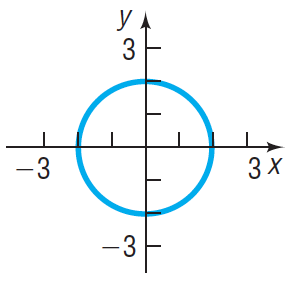

__Sln__: Any vertical line with equation $x=a, -2 \lt a \lt 2$ intersects the graph in more than one point&mdash;one below the $x$-axis, one above, so $\box{\text{not a function}.}~$ (Note that even though this is not a function, the intercepts and symmetries are still well-defined: the $x$-intercepts are $(\pm2,0)$, the $y$-intercepts are $(0,\pm2)$, and it is symmetric with respect to the origin and both axes.)
  

<a name="2.22" class="goback" onclick="winhisback()">__22__</a>) 

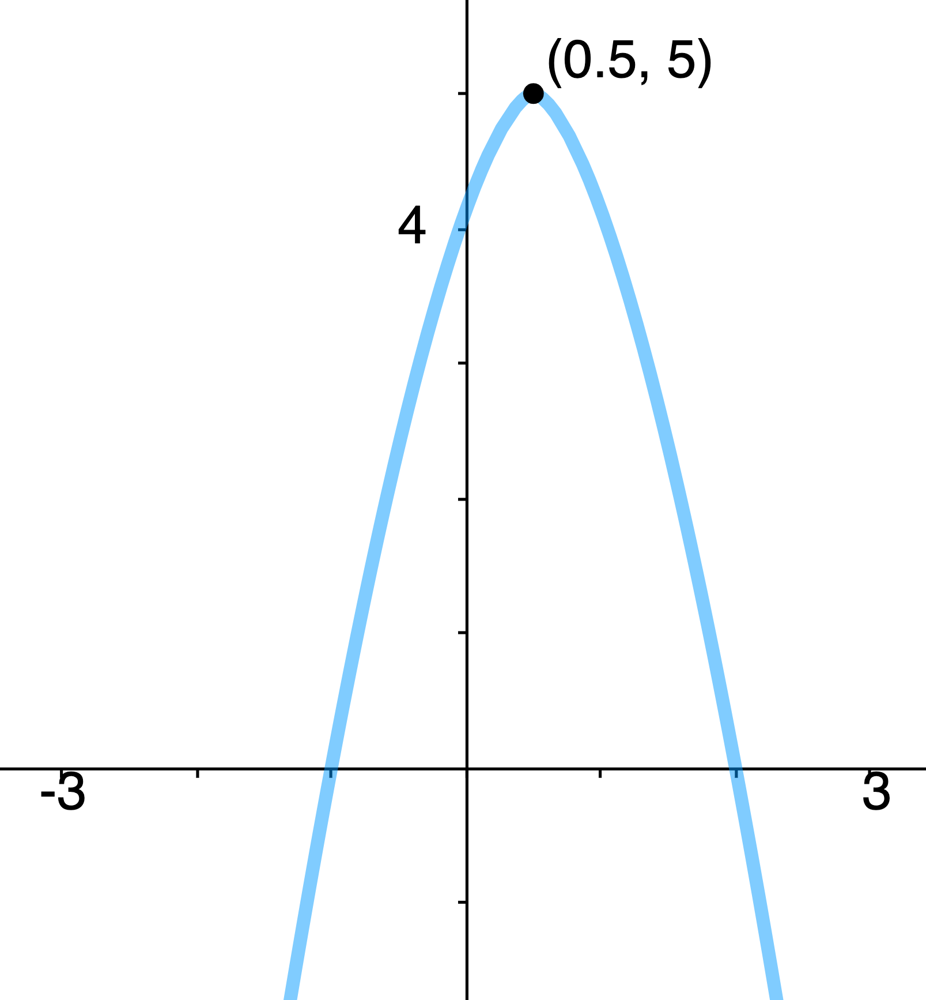

__Sln__: Any vertical line intersects the graph only once, so it is the graph of a $\box{\text{function}}.$ __a__) By convention, the absence of points indicating where the graph terminates implies that the graph continues on forever, in both directions horizontally and in the negative direction vertically; thus the $\box{\text{domain is all real numbers }=\mathbb{R}=(-\infty,\infty),}$ and the range is $\box{(-\infty,5]}$ (all real numbers less than or equal to 5); __b__) it appears to have $x$-intercepts of $(-1,0)$ and $(2,0)$, and a $y$-intercept at or a little above $(0,4)$ (that’s the inherent difficulty in determining and citing values from graphs: they can never be precise); __c__) it is not symmetric with respect to the origin or either axis (it is symmetric with respect to the line $x=0.5$, however).
  

<a name="2.26" class="goback" onclick="winhisback()">__26__</a>) 
Given $f(x) = \Frac{x^2 + 2}{x + 4}$: __a__) Is $\left(1,\Frac35\right)$ on the graph of $f$? __b__) What is $f(0)$ and what is this point on the graph? __c__) Find $x$ such that $f(x) = \Frac12$ and state which point(s) this is (or these are) on the graph of $f$. __d__) What is the domain of $f$? __e__ & __f__) List the $x$ and $y$-intercepts (if any).

__Sln__: __a__) A point $(x,y)$ is on the graph of $y=f(x)$ if $(x,y)$ makes the equation $y=f(x)$ a true statement; since $f(1) = \Frac{1^2 + 2}{1 + 4} = \Frac35, \left(1,\Frac35\right)~\box{\text{is}}$ on the graph of $f.$ 
 
 
__b__) $f(0) = \Frac{0^2 + 2}{0 + 4} = \Frac24 = \box{\Frac12}$, and thus the corresponding point on the graph is $\box{\left(0,\Frac12\right)}.$ 
 

__c__) We need $x$ such that $\displaystyle \frac{x^2 + 2}{x + 4} = \frac12$ and we’ve already found one such, $\box{x=0}$; to find any others, multiply through by $2(x+4)$ to yield $2x^2+4=x+4 \implies 2x^2-x = 0 = x(2x-1) = 0 \implies 2x-1=0 \implies \box{x=\frac12}$ (check: $\Frac{(1/2)^2+2}{1/2 + 4} = \Frac{9/4}{9/2}=\Frac12~\checkmark$), which means the points $\box{\left(0,\frac12\right)\text{ and }\left(\frac12,\frac12\right)}$ are on the graph of $f.$ 
 

__d__) The domain is all real numbers ___except___ any that make $f$ undefined; in this case, the only thing that can make $f$ undefined is division by zero, i.e., if $x+4 = 0 \implies x=-4$, so this is the point we must exclude from the domain; thus the domian is $\boxed{\left\{x\in\mathbb{R}: x\ne -4\right\}.}$
 

__e__ & __f__) The $y$-intercept happens when $x=0$, and we’ve already found that $y$ value, so the $y$-intercept is $\boxed{\left(0,\frac12\right)}$; the $x$-intercepts happen where $y=0$, so we must solve $\displaystyle \frac{x^2 + 2}{x + 4} = 0 \implies x^2+2=0$ which has no real solution, so the graph of this $f$ has $\boxed{\text{no }x\text{-intercepts.}}$
  

<a name="2.30" class="goback" onclick="winhisback()">__30__</a>) 
<b>Granny Shots</b> The path of the ball in an underhand [basketball] foul shot, releasing the ball at a 70° angle from a position 3.5 feet above the floor, can be modeled by the function:
$$h(x) = -\frac{136x^2}{\u^2} + 2.7x + 3.5$$
where $h$ is the height of the ball above the floor, $x$ is the forward distance of the ball in front of the foul line, and $\u$ is the initial speed of the ball in feet per second.

__a__) The center of the hoop is 10 feet above the floor and 15 feet in front of the foul line; determine the initial
speed the ball must have in order for the ball to go through the hoop.

__Sln__: $x_{final}=15, h_{final} = h(x_{final}) = h(15) = 10$, so we must solve $-\Frac{136(15)^2}{\u^2} + 2.7(15) + 3.5 = 10$ for $\u$: $\implies 2.7(15) + 3.5 - 10 = 34 = \Frac{136(15^2)}{\u^2} \implies \u = 15\sqrt{\Frac{136}{34}} = 15\sqrt4 = \box{30\text{ fps}}$ (check: $-\Frac{136(15^2)}{30^2} + 2.7(15) + 3.5 = -\Frac{136}4 + 40.5 + 3.5 = -34 + 44 = 10.~\checkmark$)
 

__b__) Write the function for the path of the ball using the velocity found in part __a__.

__Sln__: $h(x; \u=30) = -\Frac{136x^2}{30^2} + 2.7x + 3.5 = -\Frac{\cancel4(34)}{\cancel{2^2}(15^2)}x^2 + 2.7x + 3.5 = \box{-\Frac{34}{225}x^2+2.7x+ 3.5}$
 

__c__) Determine the height of the ball after it has traveled 9 feet in front of the foul line.

__Sln__: $h(9; \u=30) = -\Frac{34}{225}(9^2)+2.7(9)+ 3.5 = -\Frac{34}{\cancel{3^2}(5^2)}(9^{\cancel2 1}) + 24.3 + 3.5 = \box{15.56\text{ ft}}$
 

__d__) Find additional points and graph the path of the basketball.

__Sln__: At $x=3$ ft, $h(3; \u=30) = -\Frac{34}{\cancel{3^2}(5^2)}(\cancel{3^2})+2.7(3)+ 3.5 = \box{10.24\text{ ft}}$; $h(6; \u=30) = -\Frac{34}{\cancel{3^2}(5^2)}(\cancel{3^2}2^2)+2.7(6)+ 3.5 = \box{14.26\text{ ft}}$

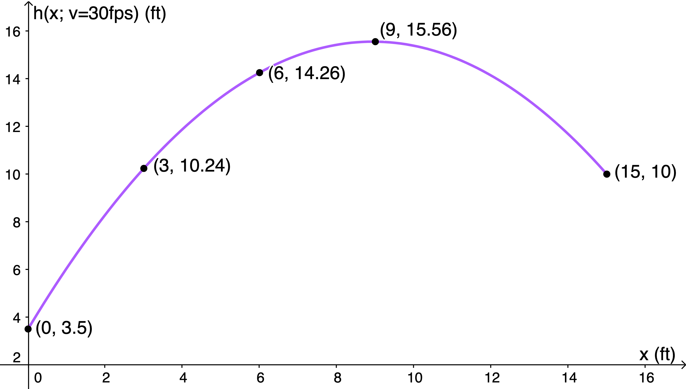

 

<a name="2.34" class="goback" onclick="winhisback()">__34__</a>) 
<b>Effect of Elevation on Weight</b> If an object weighs $m$ pounds at sea level, then its weight $W$ (in pounds) at a height of
$h$ miles above sea level is given approximately by: 
$$W(h) = m\left(\frac{4000}{4000 + h}\right)^2$$

__a__) If Amy weighs 120 pounds at sea level, how much will she weigh [at the top of] Pike’s Peak, which is 14,110 feet above sea
level?

__Sln__: Amy’s altitude is given in feet, whereas in $W(h), h$ must be in miles, so we must first convert $14110\cancel{\text{ ft}} \times \Frac{1\text{ mile}}{5280 \cancel{\text{ ft}}} = \Frac{1411}{528} \doteq 2.672\text{ mi}$; now we simply evaluate $W\left(\Frac{1411}{528}\right) = 120\left(\Frac{4000}{4000+\Frac{1411}{528}}\right)^2 \doteq 120\left(\Frac{4000}{4000+2.672}\right)^2 \doteq 120(0.999332359)^2 \doteq 120(0.998665164) = \box{119.84\text{ lbs}}$
 

__b__) Use a graphing utility to graph the function $W = W(h)$; use $m = 120$ pounds.

__Sln__: 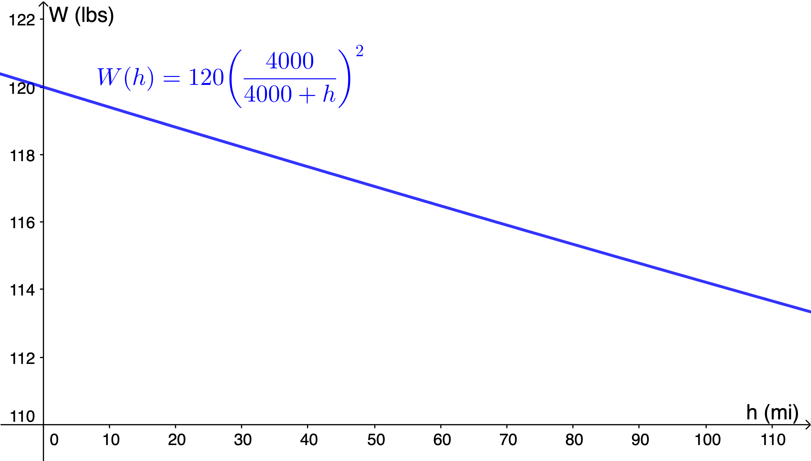
 

__c__) Left to the reader.
 

__d__ & __e__) At what height will Amy weigh 119.95 pounds?&nbsp; Does your answer seem reasonable? Explain.

__Sln__: We need to solve $119.95 = 120\left(\Frac{4000}{4000+h}\right)^2$ for $h$; begin by dividing through by $120$ to obtain $\Frac{119.95}{120} = \Frac{23.99}{24} = \left(\Frac{4000}{4000+h}\right)^2$; next, take the square-root of both sides: $\sqrt{\Frac{23.99}{24}} = \Frac{4000}{4000+h}$, and then reciprocate both sides: $\sqrt{\Frac{24}{23.99}} = \Frac{4000+h}{4000} = 1 + \Frac h{4000}$; finally, subtract $1$ from both sides: $\sqrt{\Frac{24}{23.99}} - 1 = \Frac h{4000}$, and multiply by 4000: $$\box{h = 4000\left(\sqrt{\frac{24}{23.99}}-1\right) \doteq 0.834\text{ mi}}$$
The graph in Part __b__ tells us that weight goes down with increasing altitude; since 2.672 mi is greater than 0.834 mi, we should expect her decrease in weight to be not as great at the lower altitude, so $\box{\text{yes}}$, this answer seems reasonable.
  

<a name="2.38" class="goback" onclick="winhisback()">__38__</a>) 
Is a graph that consists of a single point the graph of a function? Can you write the equation of such a function?

__Sln__: Yes: if the point has coordinates $(x,y)$, then $f$ is the function whose domain is the <i>singleton</i> set $\{x\}$; whose range is the singleton set $\{y\}$; and whose formula&mdash;given this domain and range&mdash;is simply $y=f(x).$
  

<a name="2.46" class="goback" onclick="winhisback()">__46__</a>) 
Is there a function whose graph is symmetric with respect to the $x$&#8209;axis? Explain.

__Sln__: No: in order for a graph to be symmetric wrt the $x$&#8209;axis, for each $x$ value mapped to a given $y$ value, that same $x$ value must also be mapped to $-y,$ which means one $x$ value is getting mapped to more than one $y$ value.&nbsp; This would violate the requirement that, for a relation to be a function, each domain value must be mapped to not more than one range value, so a graph symmetric wrt the $x$&#8209;axis (and we have already seen such a graph in Problem 16 above) cannot be the graph of a function.
  

## Section 3: Properties of Functions

__24__ and __26__) Use the pictured graph to __a__) identify the intercepts (if any); __b__) the domain and range; __c__) the intervals on which the function is increasing, decreasing, or constant; and __d__) whether is even, odd, or neither.

<a name="3.24" class="goback" onclick="winhisback()">__24__</a>) 

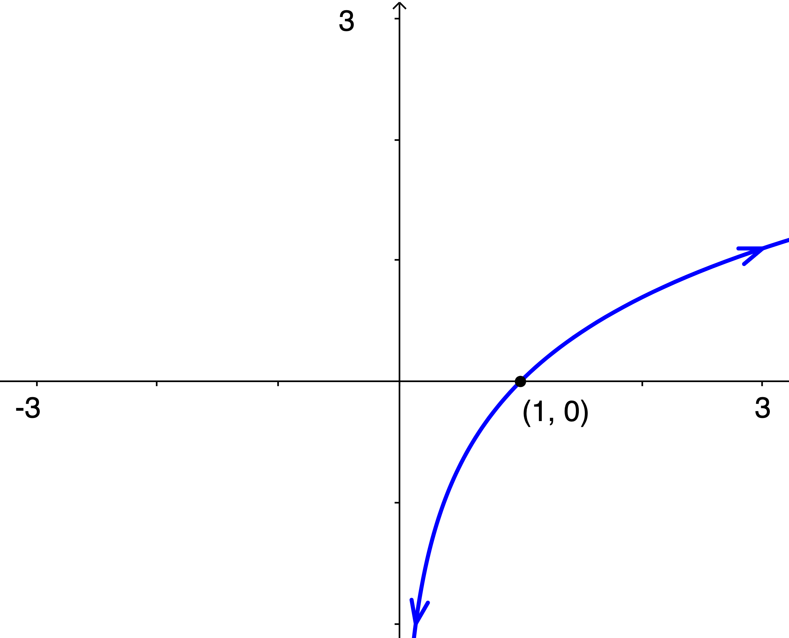

__Sln__: The arrows are "almost everything" in this problem: by convention, they imply that the function "goes down forever" to the left and "goes up forever" to the right, i.e., the range is all real numbers.&nbsp; Also by convention, if this function had a $y$&#8209;intercept, it would be shown, thus the fact that a $y$&#8209;intercept isn’t shown is understood to mean that it doesn’t have one; additionally, the fact that the left arrow indicates that the curve continues to the left as it goes down, together with the fact that it never intersects the $y$&#8209;axis, imply that the function is well-defined for ___positive___ $x$, no matter how small in absolute value, i.e., "arbitrarily close" to zero (just not zero itself, and definitely not for any negative $x$).&nbsp; Combining this with our  observation above about the right arrow, we conclude that the domain is all (strictly) positive real numbers, and that __a__) the only $x$&#8209;intercept is $\box{(1,0)}$ and there are no $y$&#8209;intercepts; __b__) $\box{\text{the domain is }\{x: x \gt 0\} = (0,\infty) \text{ in interval notation,}}$ and $\box{\text{the range is }\mathbb{R} = (-\infty,\infty)\text{ in interval notation.}}~$ __c__) As we go from left to right, the graph is always increasing, so the function is $\box{\text{increasing on its entire domain, i.e., on } (0,\infty).}~$ __d__) Since the function isn’t even defined for negative $x$, it is (trivially) $\box{\text{neither even nor odd}.}$  
  

<a name="3.26" class="goback" onclick="winhisback()">__26__</a>) 

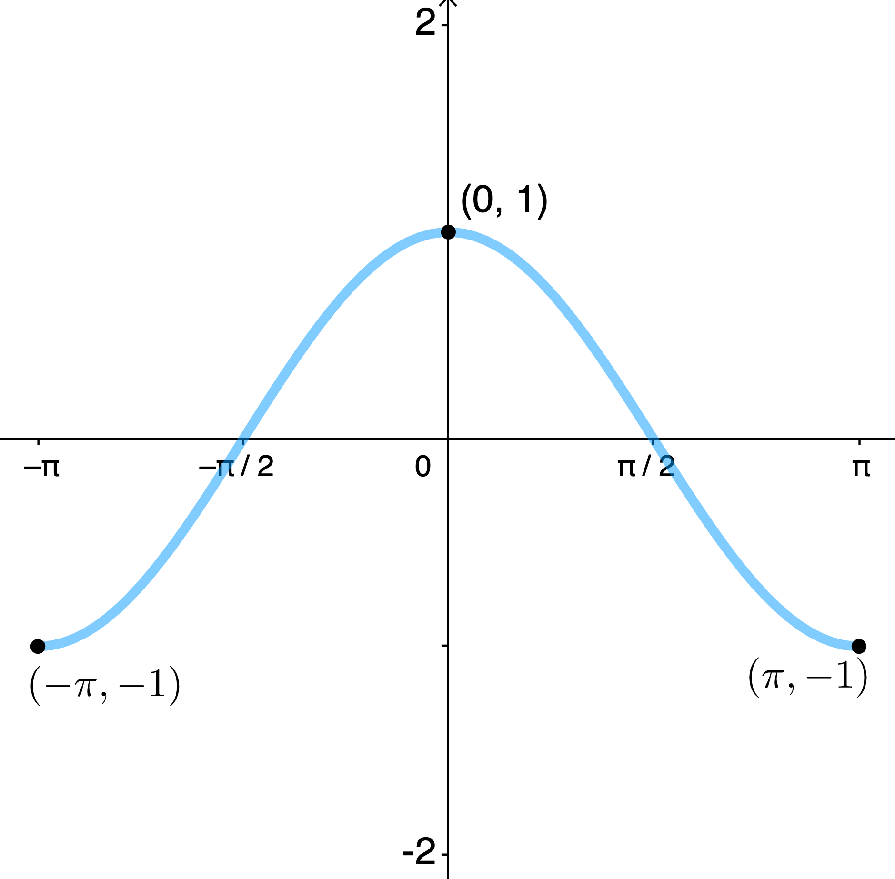

__Sln__: __a__) The graph has a clearly-indicated $\boxed{y\text{-intercept of }(0,1)}$ and implied $\boxed{x\text{-intercepts at }\left(-\frac{\pi}2,0\right)\text{ and }\left(\frac{\pi}2,0\right).}~$ __b__) Its domain is $\boxed{[-\pi,\pi]}$ (i.e., all real numbers between $-\pi$ and $\pi$, inclusive) and its range is $\boxed{[-1,1]}$ (all real numbers between $-1$ and $1$, inclusive).&nbsp; __c__) It is increasing on the open interval $\boxed{(-\pi,0)}$ and decreasing on the open interval $\boxed{(0,\pi)}.~$ __d__) It is symmetric with respect to the $y$-axis, so it is an $\boxed{\text{even}}$ function. 
  

<a name="3.30" class="goback" onclick="winhisback()">__30__</a>) Use the graph of $f(x)$ below to find: __a__) the values, if any, at which $f$ has a local maximum value and state what those local maximum values are; and __b__) same for local minimum values.

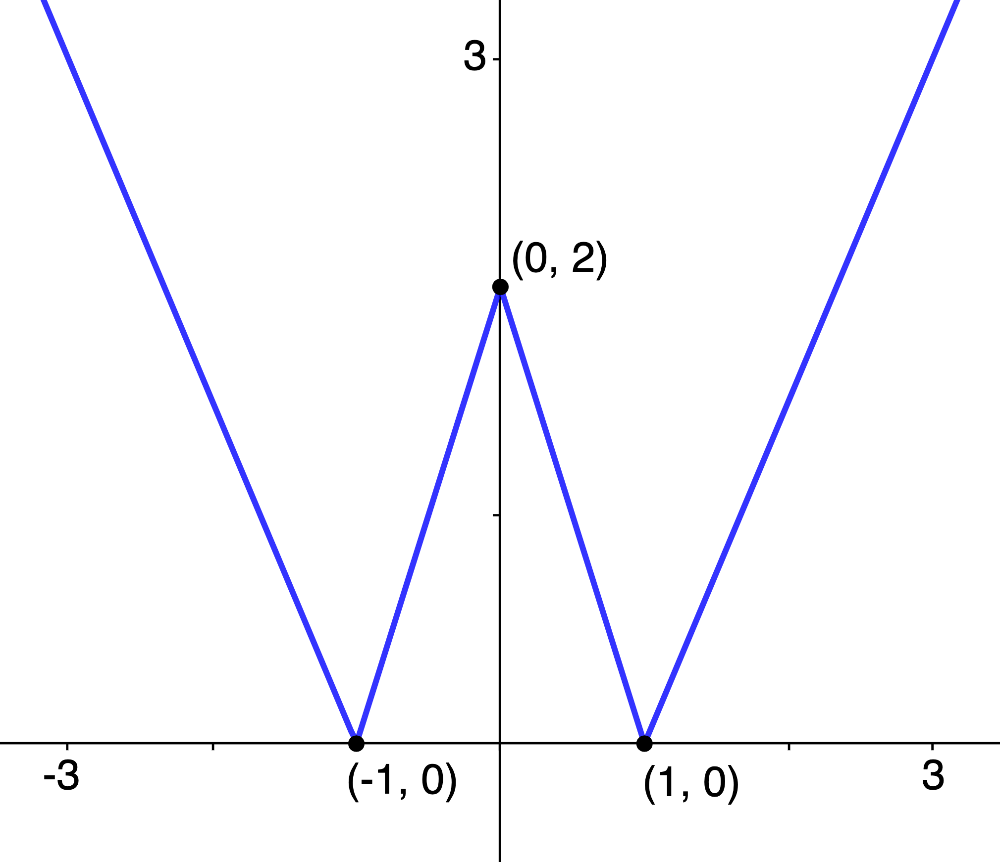

__Sln__: __a__) At $\boxed{x=0}$, $f$ has a local $\boxed{\text{maximum of }2}$; and __b__) at both $\boxed{x=-1\text{ and }x=1}$, $f$ has the same local $\boxed{\text{minimum of }0.}$
  

__36__, __40__, and __44__) Determine algebraically whether the given function is even, odd, or neither.

<a name="3.36" class="goback" onclick="winhisback()">__36__</a>) $h(x) = 3x^3 + 5$

__Sln__: $h(-x) = 3(-x)^3 + 5 = -3x^3+5 \ne 3x^3+5$ (in general), so $h$ is not even; nor does it equal $-h(x) = -3x^3-5$ (in general), so it is not odd, so it is $\boxed{\text{neither.}}$
  

<a name="3.40" class="goback" onclick="winhisback()">__40__</a>) $f(x) = \sqrt[\large3]{2x^2 + 1}$

__Sln__: $f(-x) = \sqrt[\large3]{2(-x)^2 + 1} = \sqrt[\large3]{2x^2 + 1} = f(x)$ for all $x$, so $f$ is $\boxed{\text{even.}}~$ (Note: we don’t need to check for odd-ness because a function can’t be both even and odd; proof?) 
  

<a name="3.44" class="goback" onclick="winhisback()">__44__</a>) $\ds F(x) = \frac{2x}{|x|}$

__Sln__: $\ds F(-x) = \frac{2(-x)}{|-x|} = \frac{-2x}{|x|} = -\frac{2x}{|x|} = -F(x)$ for all $x$ so $F$ is $\boxed{\text{odd.}}$
  

<a name="3.46" class="goback" onclick="winhisback()">__46__</a>) Use the graph of $f(x)$ below to find its absolute maximum and absolute minimum, if they exist.

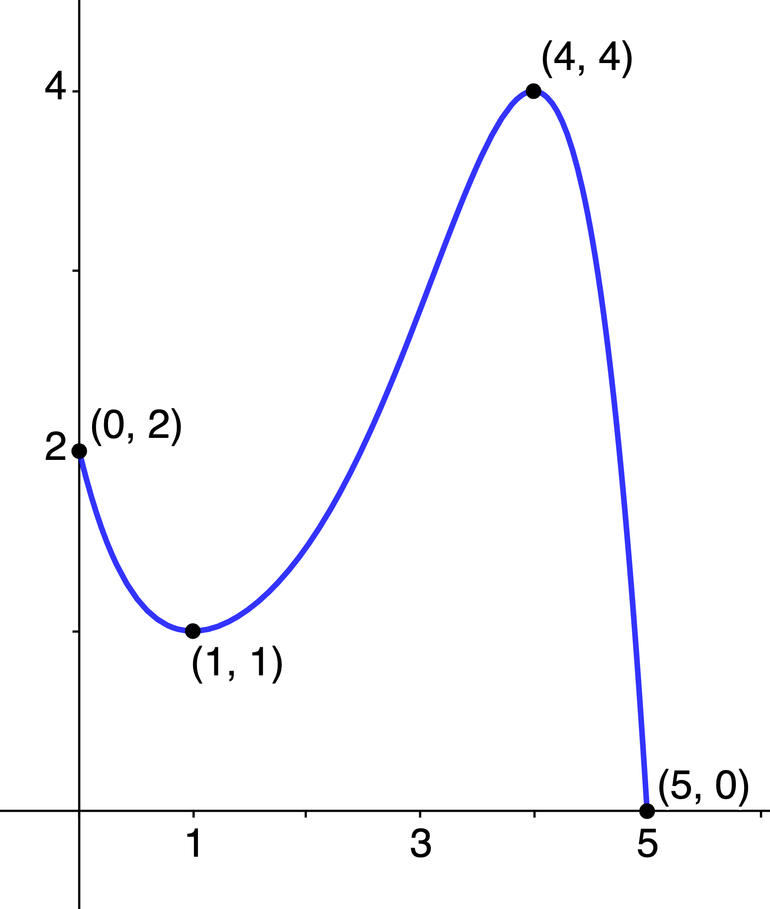

__Sln__: The absolute maximum of a function, if there is one, is the function value, not necessarily unique, closest to &quot;positive infinity&quot; of all its relative maxima.&nbsp; From the graph we see that $f$ has relative maxima of $2$ at $x=0$ and $4$ at $x=4$; since $4 \gt 2,$ the absolute maximum of of $f$ is $\box{4},$ which occurs at $\box{x=4}$ (it is just a coincidence that the maximum value equals the $x$&#8209;coordinate of where it occurs: generally, this will not be the case).&nbsp; Similarly, the absolute minimum, if there is one, is the function value, not necessarily unique, closest to &quot;negative infinity&quot; of all the function’s relative minima.&nbsp; Again, the graph tells us this $f$ has relative minima of $1$ at $x=1$ (again, just a coincidence) and $0$ at $x=5$; since $0 \lt 1$, $\box 0$ is the absolute minimum, occurring at $\box{x= 5.}$
  

__56__ and __60__) Use a graphing utility to graph each function over the indicated interval and approximate any local maximum values and local minimum values.&nbsp; Determine where the function is increasing and where it is decreasing.&nbsp; Round answers to two decimal places.

<a name="3.56" class="goback" onclick="winhisback()">__56__</a>) $f(x) = x^4 - x^2,~(-2, 2)$

__Sln__: The figure below, created using [GeoGebra](https://www.geogebra.org/calculator), includes in the left panel the inputs required to generate the graph and labeling shown in the right panel.

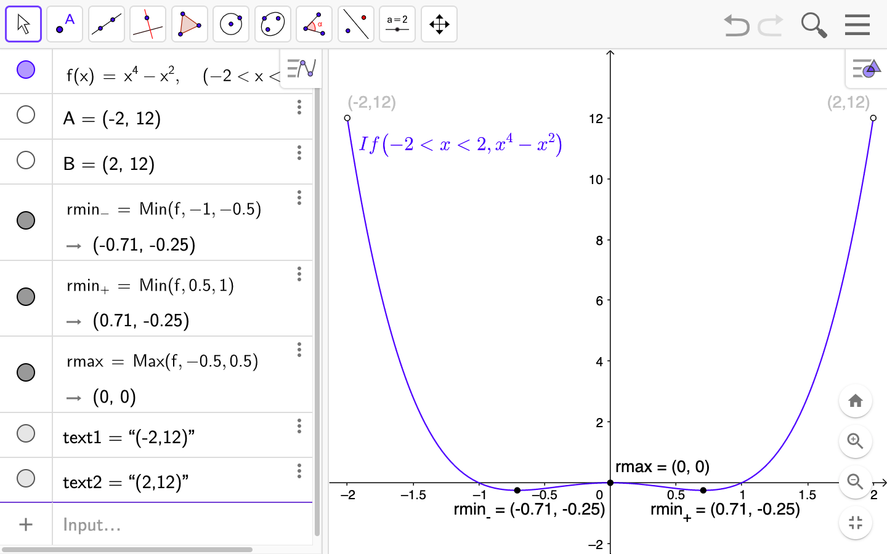

The function has $\box{\text{a local minimum of }-0.25\text{ at }x \doteq \pm0.71}$ and $\box{\text{a local maximum of }0\text{ at }x=0}$ (i.e., at the origin).&nbsp; By inspection, the function is $\box{\text{decreasing on the open intervals }-2 \lt x \lt -0.71 \text{ and } 0 \lt x \lt 0.71}$ and $\box{\text{increasing on the open intervals }-0.71 \lt x \lt 0 \text{ and } 0.71 \lt x \lt 2}.$ 
  

<a name="3.60" class="goback" onclick="winhisback()">__60__</a>) $f(x) = -0.4x^4 - 0.5x^3 + 0.8x^2 - 2,~(-3, 2)$

__Sln__:

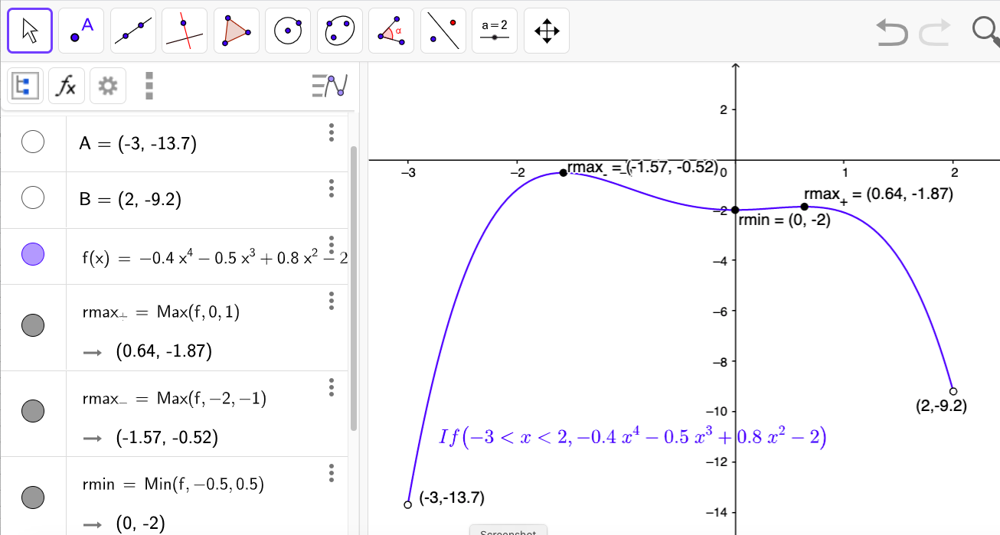

The function has two local maxima&mdash;one $\box{\doteq -0.52\text{ at }x \doteq -1.57}$ and one $\box{\doteq -1.87\text{ at }x \doteq 0.64}$ (note that maxima don’t need to be positive)&mdash;and one local minimum of $\box{-2 \text{ at } x=0}$.&nbsp; By inspection, the function is $\box{\text{increasing on the open intervals }-3 \lt x \lt -1.57 \text{ and } 0 \lt x \lt 0.64}$ and $\boxed{\text{decreasing on the open intervals }-1.57 \lt x \lt 0 \text{ and } 0.64 \lt x \lt 2}.$ 
  

<a name="3.66" class="goback" onclick="winhisback()">__66__</a>) For $f(x) = -4x + 1$, find: __a__) the average rate of change from $x=2$ to $x=5$; and __b__) an equation of the secant line containing $(2,f(2))$ and $(5,f(5))$.

__Sln__: __a__) By definition, the average rate of change of $f$ from $x=2$ to $x=5$ is: $\Frac{f(5)-f(2)}{5-2} = \Frac{-4(5)+1-(-4(2)+1)}3 = \Frac{-19-(-7)}3 =$ $\Frac{-12}3 = \box{-4}$.

__b__) The secant line between two points of a line is simply the line itself (proof?), thus the required equation is simply $\box{y=-4x+1}.$
  

<a name="3.70" class="goback" onclick="winhisback()">__70__</a>) For $h(x) = -2x^2 + x$, find: __a__) the average rate of change from $x=0$ to $x=3$; and __b__) an equation of the secant line containing $(0,h(0))$ and $(3,h(3))$.

__Sln__: For both parts, we need the values of $h(0) = -2(0^2) + 0 = 0$ and $h(3) = -2(3^2) + 3 = -15.~$ Therefore, the average rate of change (__a__) is $\Frac{h(3)-h(0)}{3-0} = \Frac{-15}3 = \box{-5}$ and the equation of the secant line (__b__) is the equation of the line containing the points $(0,0)$ and $(3,-15).~$ Now, the equation of any (oblique) line containing the origin is of the form $y=mx$ (why?), so we simply need to find $m$ from the fact that $-15=m(3)$ must be a true statement; this implies $m=-5$, so the equation of the secant line is: $$\box{y = -5x}$$

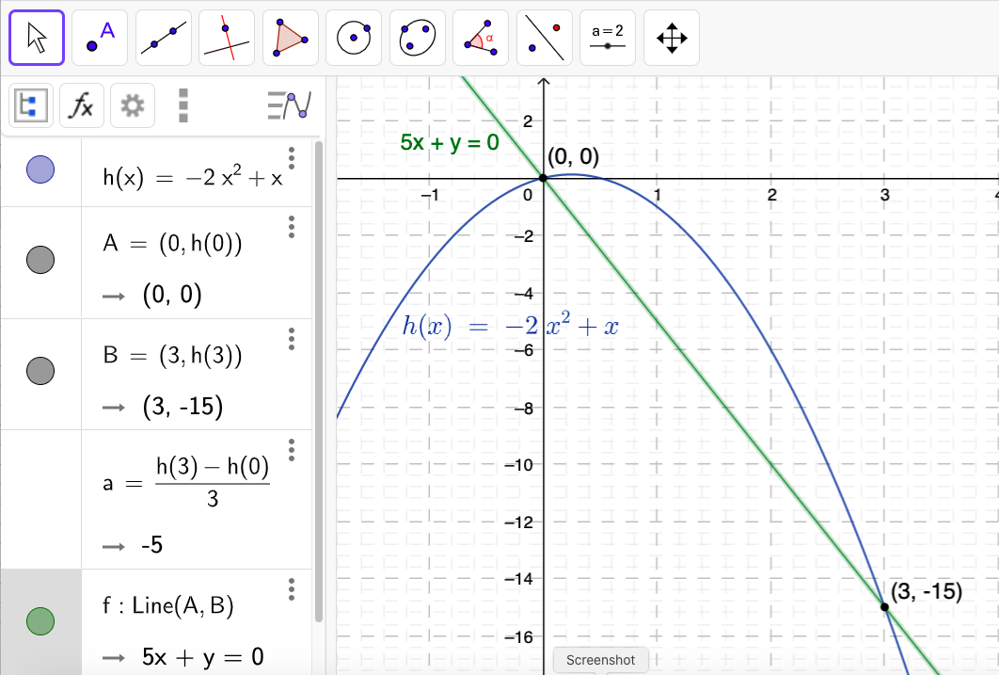

 

<a name="3.74" class="goback" onclick="winhisback()">__74__</a>) Given $G(x) = -x^4 + 32x^2 + 144$

__a__) Determine whether $G$ is even, odd, or neither. 

__Sln__: $G(-x) = -[(-x)^4] + 32[(-x)^2] + 144 = -(-1)^4x^4 + 32(-1)^2x^2 + 144 = -x^4 + 32x^2 + 144 = G(x)$ for all $x$, therefore $G(x)$ is $\box{\text{even.}}$
 

__b__) There is a local maximum value of 400 at $x = 4$; determine a second local maximum value.
__Sln__: Since $G(x)$ is even, it is symmetric about the $y$-axis; therefore, if $G(4)$ is a local maximum, so must be $G(-4) = G(4) = 400$, i.e., $\box{(-4,400)}$ is a second local maximum.
 

__c__) Suppose the area under the graph of $G$ between $x = 0$ and $x = 6$ that is bounded below by the $x$-axis is 1612.8 square units; using the result from part __a__), determine the area under the graph of $G$ between $x = -6$ and $x = 0$ bounded below by the $x$-axis.

__Sln__: Again, since $G$ is even, and therefore symmetric about the $y$-axis, the area described between $x = -6$ and $x = 0$ must equal the same area between $x = 0$ and $x = 6$, i.e., $\box{1612.8\text{ square units}}.~$ Here’s a picture:

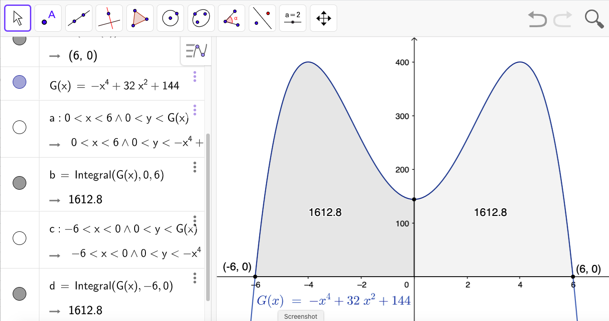

(Note: the use of GeoGebra’s Integral function to compute the areas of the described regions is beyond the scope of this course, though, perhaps arguably, the method by which the described regions are defined and graphed, is not.)
  

<a name="3.76" class="goback" onclick="winhisback()">__76__</a>) __Medicine Concentration__ The concentration, $C$, of a medication in the bloodstream $t$ hours after being administered is modeled by the function:

$$C(t) = -0.002t^4 + 0.039t^3 - 0.285t^2 + 0.766t + 0.085$$

__a__) After how many hours will the concentration be highest?

__Sln__: In other words, at what time will $C$ attain a maximum?&nbsp; Until Calculus, we need to use a graphing utility to answer this question:

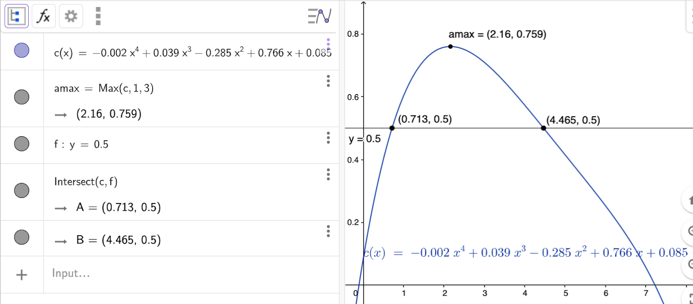

(for now, ignore the added line $y=0.5$: it is there for the solution to part __b__).&nbsp; Using GeoGebra’s Max command, we find the concentration will be highest approximately $\box{2.16\text{ hours} = 2\text{ hrs, }9.6\text{ min.}}$ after the medicine has been administered.
 

__b__) A woman nursing a child must wait until the concentration is below 0.5 before she can nurse him.&nbsp; After taking the medication, how long must she wait before nursing her child?

__Sln__: We need the time(s) after administration at which the concentration is less than 0.5, i.e., $t$ such that $C(t)\lt 0.5$; we don’t have the &quot;algebraic machinery&quot; to figure this out algebraically, so we need to solve it graphically using technology.&nbsp; One way to do this is illustrated in the graph above: we superimpose the graph of $y=0.5$ on the graph of $C(t)$ and the times for which the graph of $C(t)$ is below the graph of $y=0.5$ are the time ranges in which it is OK to nurse.&nbsp; But note that the graph of $C(t)$ starts out below $y=0.5$: $C(0)=0.085 \lt 0.5$, so if it is really true that she can nurse anytime the concentration is below $0.5$, she can nurse from immediately after medicine administration until the time at which the concentration first equals $0.5$, which we see using GeoGebra’s Intersect command is $\box{\doteq 0.713\text{ hr }= 42.8\text{ min}}.$&nbsp; Then the graph of $C$ is above the graph of $y=0.5$&mdash;C \gt 0.5$&mdash;until $\box{t \doteq 4.46\text{ hrs.} = 4 hr, 27.6 min.},$ so this is how long the woman must wait until after administration to nurse, if she is not allowed to nurse right away.
  

<a name="3.80" class="goback" onclick="winhisback()">__80__</a>) For the function $f(x) = x^2$ compute each average rate of
change: __a__) from $x=1$ to $x=2$; __c__) from $x=1$ to $x=1.1$; __e__) from $x=1$ to $x=1.001$; __h__) what is happening to the slopes of the secant lines? Is there some number that they are getting closer to?
What is that number?

__Sln__: 

__a__) $\ds\frac{f(2)-f(1)}{2-1} = \frac{2^2-1^2}1 = \box3$

__c__) $\ds\frac{(1.1)^2-1^2}{1.1-1} = \frac{1.21-1}{0.1} = \frac{0.21}{0.1} = \box{2.1}$

__e__) $\ds\frac{(1.001)^2-1^2}{1.001-1} = \frac{1.002001-1}{0.001} = \frac{0.002001}{0.001} = \box{2.001}$

__h__) As the upper $x$ value, $x_{upper}$, &quot;approaches&quot; the (fixed) lower value, $x_{lower}$ ($1$ in this example), the slope of the secant line between the points $(x_{lower},f(x_{lower}))$ and $(x_{upper},f(x_{upper}))$, i.e., the average rate of change of $f$ from $x_{lower}$ to $x_{upper}$, appears to be approaching the (fixed) value $\box{2}.~$ (In Calculus one learns how to derive this result using a more general, and also more rigorous, analysis.&nbsp; In the meantime, the student is encouraged to contemplate why a more rigorous analysis might be desirable&mdash;hint: does a collection of examples prove a general statement; what if someone comes along some day and finds an example which contradicts the general statement?&mdash;and contemplate what that more rigorous analysis might &quot;look like&quot;&mdash;hint: what is needed is an analysis that is independent of any specific numerical examples.)
  

<a name="3.88" class="goback" onclick="winhisback()">__88__</a>) Given the following definition for the slope, $m_{\large\text{sec}}$, of the secant line for $f(x)$ through the points $(x,f(x))$ and $(x+h,f(x+h))$: $$m_{\large\text{sec}} = \frac{f(x+h)-f(x)}h,~ h\ne0,$$
for $f(x)=x^{-2}$: 

__a__) Express the (simplified) slope of the secant line in terms of $x$ and $h$.

__Sln__: $\ds m_{\large{\text{sec}}} = \frac{f(x+h)-f(x)}h = \frac{(x+h)^{-2}-x^{-2}}{h} = \frac1h\left[\frac1{(x+h)^2}-\frac1{x^2}\right] = \frac1h\left[\frac{x^2-(x+h)^2}{x^2(x+h)^2}\right] = \frac1h\left[\frac{x^2-x^2-2hx-h^2}{x^2(x+h)^2}\right] = $ $\ds \frac1h\left[\frac{-2hx-h^2}{x^2(x+h)^2}\right] = \box{\frac{-2x-h}{x^2(x+h)^2}}.$ (Make sure you understand the last step in this derivation and why it is OK&mdash;hint: would it be OK if $h=0$? Why can’t this happen?)
 

__b__) Find $m_{\large\text{sec}}$ for $h = 0.5, 0.1,$ and $0.01$ at $x=1.~$ What value does $m_{\large\text{sec}}$ approach as $h$ approaches (but doesn’t equal) $0$?

__Sln__: $m_{\large\text{sec}}(x=1;h=0.5) = \ds \frac{-2(1)-0.5}{1^2(1+0.5)^2} = \frac{-2.5}{(1)(1.5)^2} = \frac{-2.5}{2.25} = \box{-\frac{10}9 = -1.\bar1}$

$m_{\large\text{sec}}(x=1;h=0.1) = \ds \frac{-2.1}{(1.1)^2} = \frac{-2.1}{1.21} = \box{-\frac{210}{121} \doteq -1.73553719}$

$m_{\large\text{sec}}(x=1;h=0.01) = \ds \frac{-2.01}{(1.01)^2} = \frac{-2.01}{1.0201} = \box{-\frac{20100}{10201} \doteq -1.97039506}$

$m_{\large\text{sec}}(x=1)$ appears to be approaching $\box{-2}$ as $h$ approaches $0$.
 

__c__) Find the equation for the secant line at $x = 1$ with $h = 0.01$.

__Sln__: We just computed the required slope in the previous exercise, so we use the point-slope form for the equation of a line: $y-y_0=m(x-x_0)$ where $x_0 = 1, y_0 = f(1) = 1^{-2} = 1, m = \ds -\frac{20100}{10201} \implies 10201(y-1)=-20100(x-1) \implies$ $$\box{20100x+10201y=30301}\text{ or } \box{y = -\frac{20100}{10201}x+\frac{30301}{10201} \doteq -1.970x + 2.970}$$
 

__d__) Use a graphing utility to graph $f$ and the secant line found in part __c__) in the same viewing window

__Sln__: 
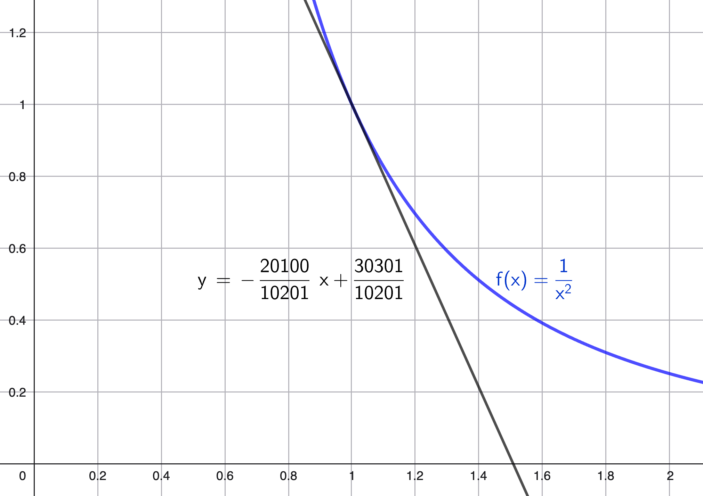

Observe the domain over which the line very closely approximates the function; a secant line intersects a curve in two points: do this exercise yourself and keep zooming in until you can clearly see those two points and note how zoomed in you have to be.
  

## Section 4: Library of Functions; Piecewise-defined Functions

__32__, __36__, and __40__: __a__) Find the domain of the given function; __b__) locate any intercepts; __c__) graph the function;
__d__) based on the graph, find the range; __e__) is $f$ continuous on its domain?

<a name="4.32" class="goback" onclick="winhisback()">__32__</a>) 
$f(x) = \left\{\begin{array} \\ x + 3 & \text{if } x \lt -2 \\
-2x - 3 & \text{if } x \ge -2\end{array}\right.$

__Sln__:
  

<a name="4.36" class="goback" onclick="winhisback()">__36__</a>) 
$f(x) = \left\{\begin{array} \\ x^{-1} & \text{if } x \lt 0 \\
\sqrt[\large3]x & \text{if } x \ge 0\end{array}\right.$ 

__Sln__:
  

<a name="4.40" class="goback" onclick="winhisback()">__40__</a>) 
$f(x) = \text{int}(2x)$

__Sln__:
  

<a name="4.44" class="goback" onclick="winhisback()">__44__</a>) 
Write a definition for the piecewise-defined function whose graph is:

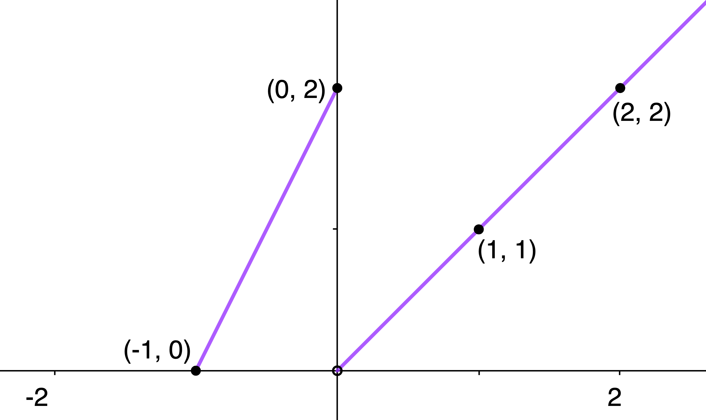

__Sln__:
  

<a name="4.46" class="goback" onclick="winhisback()">__46__</a>) 
If $f(x) = \text{int}\left(\Frac x2\right)$ find __a__) $f(1.2)$; __b__) $f(1.6)$; and __c__) $f(-1.8)$

__Sln__:
  

<a name="4.52" class="goback" onclick="winhisback()">__52__</a>) 
__Federal Income Tax__ Given the following revised &quot;Y-1&quot; 2009 tax rate schedule:

| Taxable Income Is Between | Tax Is This Plus | This % | Of The Excess Over |
| --- | --- | --- | --- |
| 0 - 16,700 | 0 | 10% | 0  |
| 16,700 - 67,900 | 1,670.00 | 15% | 16,700 |
| 67,900 - 137,050 | 9,350.00 | 25% | 67,900 |
| 137,050 - 208,850 | 26,637.50 | 28% | 137,050 |
| 208,850 - 372,950 | 46,741.50 | 33% | 208,850 |
| 372,950 - $\infty$ | 100,894.50 | 35% | 372,950 |

Construct a function $y = f(x)$ for Schedule Y-1.

__Sln__:
  

<a name="4.56" class="goback" onclick="winhisback()">__56__</a>) 
__Interest Payments for Credit Cards__ A credit card company charges the card holder interest of 1.5% per month for the first \$1000 owed, and 1% per month on any unpaid balance over \$1000; find and graph the function $g$ that gives the amount of interest charged per month on a balance of $x$ dollars.

__Sln__:
  

<a name="4.68" class="goback" onclick="winhisback()">__68__</a>) 
Consider the equation:
$$y=\left\{
\begin{array} \\
1&\text{   if }x\text{ is rational} \\
0&\text{   if }x\text{ is irrational}
\end{array} 
\right.$$
Is this a function?&nbsp; What is its domain?&nbsp; What is its range?&nbsp; What is its $y$&#8209;intercept, if any?&nbsp; What are its $x$&#8209;intercepts, if any?&nbsp; Is it even, odd, or neither?&nbsp; How would you describe its graph?

__Sln__:
  

## Section 5: Graphing Techniques: Transformations

__20__ and __26__) Write the function whose graph is the graph of $y = x^3$, but is:

<a name="5.20" class="goback" onclick="winhisback()">__20__</a>) Shifted to the left 4 units.

__Sln__:
  

<a name="5.26" class="goback" onclick="winhisback()">__26__</a>) Horizontally stretched by a factor of 4.

__Sln__:
  

<a name="5.30" class="goback" onclick="winhisback()">__30__</a>) What function results from transforming $y=\sqrt x$ by an &quot;up-shift&quot; of 2 units, followed by a reflection about the $y$&#8209;axis, followed by a &quot;left-shift&quot; of 3 units?

__Sln__:
  

<a name="5.38" class="goback" onclick="winhisback()">__38__</a>) Suppose that the function $y=f(x)$ is decreasing on the interval $(-2,7).~$ Over what interval is the graph of __a__) $y = f(x + 2)$ and __b__) $y = f(x - 5)$ decreasing, and what can be said about the graph of __c__) $y = -f(x)$ and __d__) $y = f(-x)$.

__Sln__:
  

__46__, __54__, __58__, and __62__) Graph each function using the techniques of shifting, compressing, stretching, and/or reflecting: start with the graph of the basic function, and show all stages; be sure to show at least three key points; and specify the domain and the range of each function.

<a name="5.46" class="goback" onclick="winhisback()">__46__</a>) 
$f(x) = (x + 2)^3 - 3$

__Sln__:
  

<a name="5.54" class="goback" onclick="winhisback()">__54__</a>) 
$g(x) = 3\left|x + 1\right| - 3$

__Sln__:
  

<a name="5.58" class="goback" onclick="winhisback()">__58__</a>) 
$f(x) = -4\sqrt{x - 1}$

__Sln__: The first is transformation horizontally shifting $y = \sqrt{x}$ one unit to the right, followed by a reflection through the $x$-axis and a vertical &quot;stretch&quot; by a factor of four (these last two transformations can be performed in either order); here’s a graph showing each step:

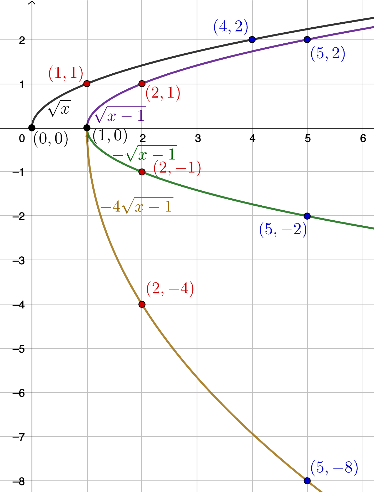

The final domain is $x \ge 1$ and the final range is $y \le 0.$
  

<a name="5.62" class="goback" onclick="winhisback()">__62__</a>) 
$h(x) = \text{int}(-x)$

__Sln__: $h(x)$ is $\text{int}(x)$ reflected through the line $x = 0$, so each $x$ gets multiplied by $-1$ and then ___rounded up___ to the nearest integer:

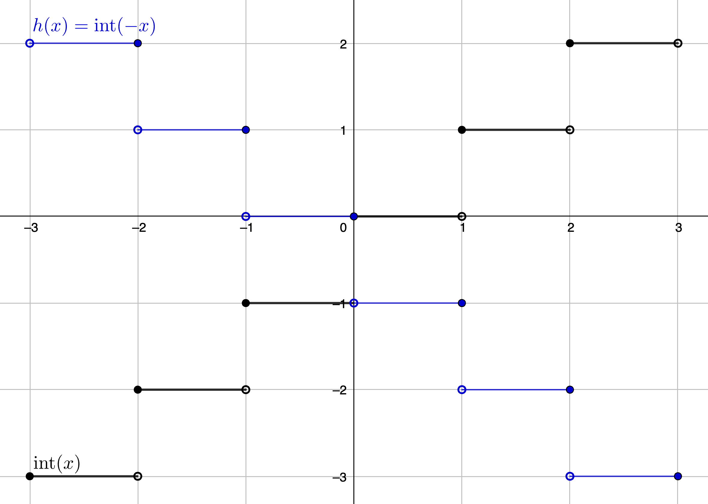

The domain is all real numbers and the range is the integers.
  

<a name="5.66" class="goback" onclick="winhisback()">__66__</a>) 
Use the following graphical definition of $f(x)$:

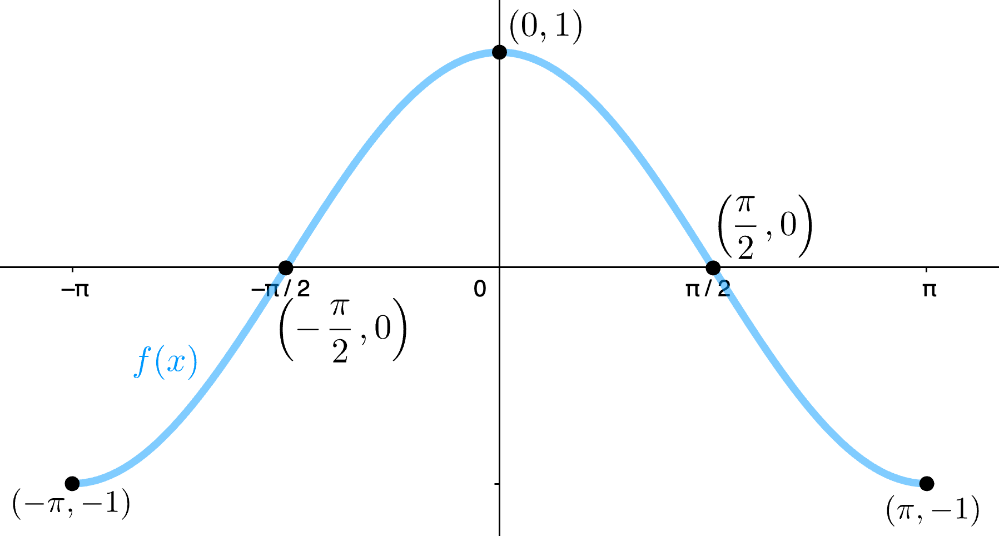

to graph __b__) $G(x) = f(x + 2)$; __d__) $H(x) = f(x + 1) - 2$; and __g__) $h(x) = f(2x).$

__Sln__: __b__) $G(x) = f(x + 2)$ is the same as $f(x)$, horizontally shifted two units to the left, i.e., by $-2$; so, for example, the points $(-\pi, -1), (-\pi/2, 0), (0,1), (\pi/2, 0), (\pi, -1)$ gets shifted, respectively, to $(-2 - \pi, -1), (-2 -\pi/2, 0), (-2,1), (-2+\pi/2, 0), (-2+\pi, -1)$ and in general $(x, f(x))$ gets shifted to $(x-2, f(x)).$&nbsp; Here’s the required graph, showing both the parent and the shifted functions:

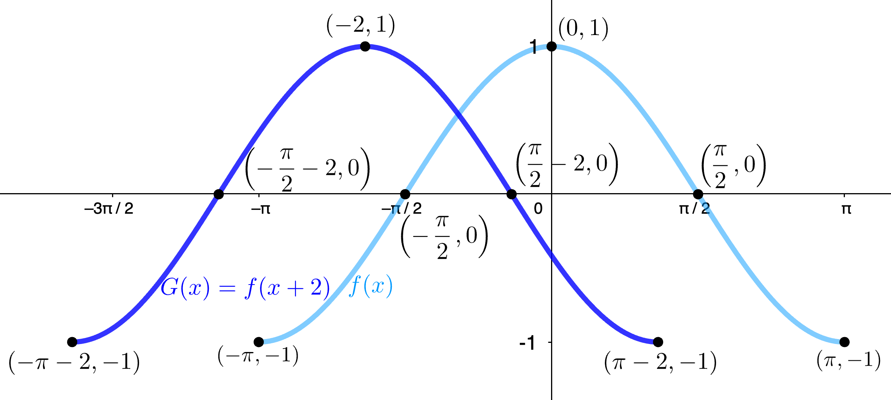

__d__) $H(x) = f(x + 1) - 2$ is $f(x)$ shifted horizontally $-1$ unit and then shifted vertically $-2$ units; here’s the graph of $f$ and $H$:

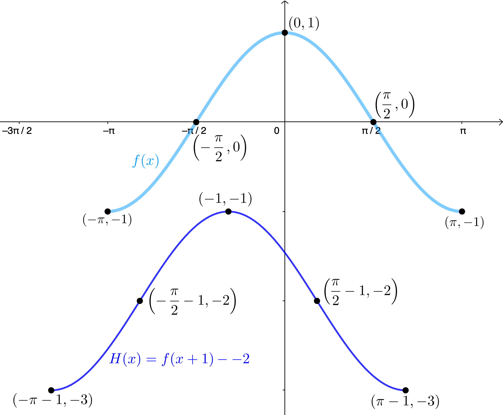

__g__) $h(x) = f(2x)$ is $f$ compressed horizontally by a factor of 2; so, for example, $(-\pi,-1)$ becomes $\left(-\Frac{\pi}2,-1\right)$, $(0,1)$ stays fixed, $(\pi,-1)$ becomes $\left(\Frac{\pi}2,-1\right)$ and in general $(x, f(x))$ becomes $\left(\Frac x2, f(x)\right)$; here’s a graph showing both functions:

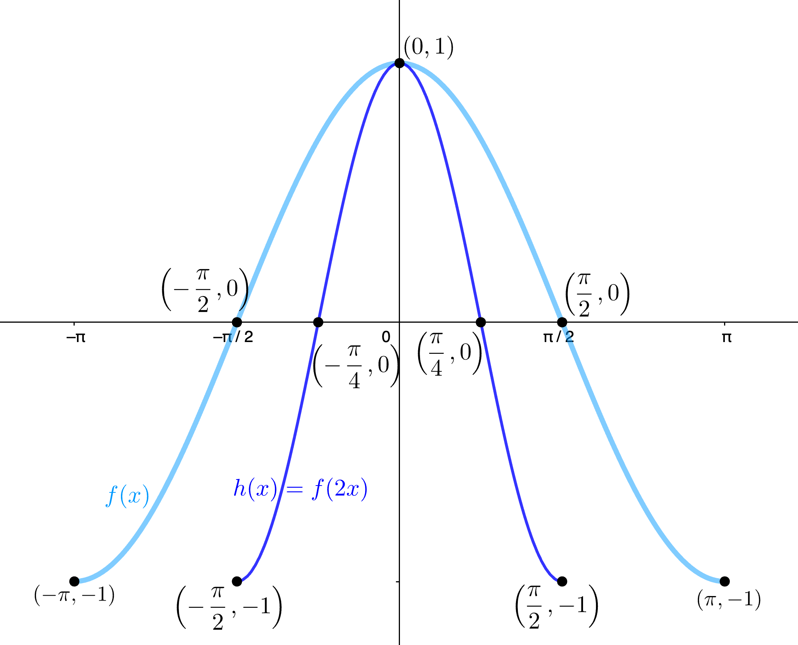

 

<a name="5.80" class="goback" onclick="winhisback()">__80__</a>) 
__Period of a Pendulum__ The period $T$ (in seconds) of a simple pendulum is a function of its length $\ell$ (in feet) defined by: $$T = 2\pi\sqrt{\frac{\ell}g}$$
where $g \doteq 32.2$ feet per second per second (ft&#8209;sec$^{-2}$) is the acceleration due to gravity at sea level.

__a__, __b__, and __c__) Use a graphing utility to graph $T = T(\ell), T(\ell + 1), T(\ell+2), T(\ell + 3)$ and discuss how adding to the length $\ell$ changes the period $T.$

__Sln__: Here’s the required graph, generated using GeoGebra:

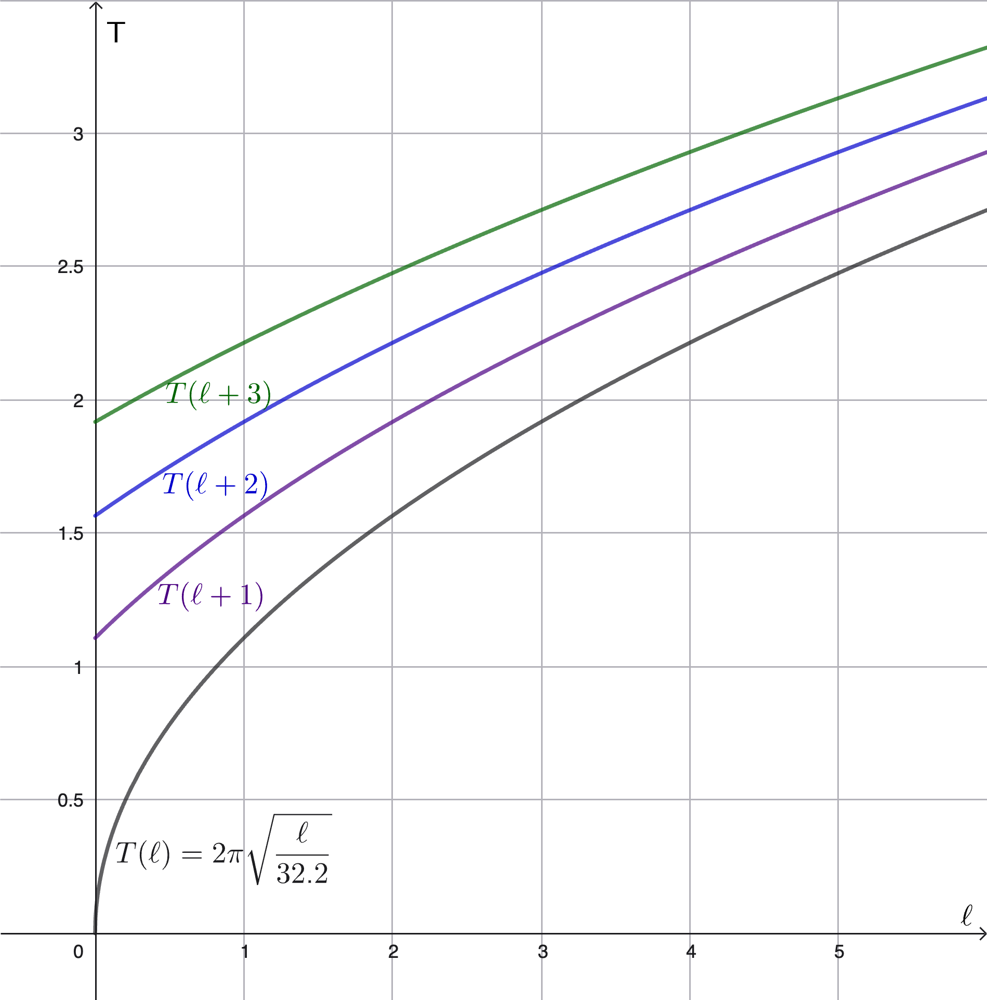

Incrementing the function input, represented by $\ell + x, x \gt 0$, increases the value of the period over the entire domain of $\ell$ (note that although the mathematical function has a domain which extends into negative values of $\ell$, because we add to $\ell$ before evaluating the function, $\ell + x$ always represents the length of the pendulum and thus it doesn’t make physical sense for $\ell + x \le 0.$)&nbsp; Additionally, we see that each increment of $\ell$ by 1 appears to displace the $T$-intercept by a decreasing amount; but the distance between the curves appears to be approaching a constant as $\ell$ increases: the ambitious reader is encouraged to try to prove or disprove this hypothesis.
 

__d__ and __e__) Do the same for $T(2\ell), T(3\ell), T(4\ell).$

__Sln__: Here’s the required graph:

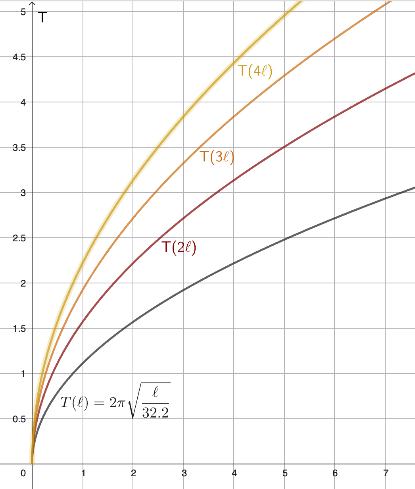

Because the $T$-intercept of the &quot;parent&quot; function occurs at $\ell=0$, multiplying $\ell$ by a number before putting it into the function does not change the $T$-intercept, which in this case is zero (and the domain restriction necessary on physical grounds in parts a-c is unnecessary here).&nbsp; Otherwise, the graphical evidence suggests that, if $b \gt a \gt 1,$ then: 1)  $T(b\ell) \gt T(a\ell)$ for all $\ell$; and 2) the distance between $T(a\ell)$ and $T(b\ell)$ increases as $\ell$ increases.&nbsp; (Again, the ambitious reader is encouraged to try to prove these results.)
  

<a name="5.84" class="goback" onclick="winhisback()">__84__</a>) 
Suppose $(1, 3)$ is a point on the graph of $y=f(x)$; what point (does this imply) is on the graph of: __a__) $y = f(x + 3) - 5$; __b__) $y = -2f(x - 2) + 1$; __c__) $y = f(2x + 3)$.

__Sln__: $(1,3)$ on the graph of $y=f(x)$ means that whenever the input to $f$ is $1$, the output will be $3$, ___and this is all we know about___ $f$.&nbsp; Consequently, for example, we don’t know what $f(1+3) = f(4)$ is, but:

__a__) Setting $x+3 = 1 \implies x = -2$ so we do know that $f(-2 + 3) = f(1) = 3 \implies f(-2+3) - 5 = -2 \implies \box{(-2,-2)}$ is on the graph of $y = f(x+3) - 5.$
 

__b__) Setting $x-2 = 1 \implies x = 3$ so $-2f(3-2) + 1 = -2f(1) + 1 = -2(3) + 1 = -5$ so $\box{(3,-5)}$ is on the graph of $y = -2f(x-2) + 1.$
 

__c__) Setting $2x + 3 = 1 \implies x = -1$ so $f(2(-1) + 3) = f(1) = 3 \implies \box{(-1,3)}$ is on the graph of $y = f(2x+3).$ 
  

## Section 6: Mathematical Models: Building Functions

<a name="6.4" class="goback" onclick="winhisback()">__4__</a>) 
Let $P = (x, y)$ be a point on the graph of $y=\Frac1x$. __a__) Express the distance $d$ from $P$ to the origin as a function
of $x$; __b__) use a graphing utility to graph $d(x)$; __c__) for what values of $x$ is $d$ smallest?

__Sln__: __a__) The distance from the origin to the point $(x,y)$ is $d = \sqrt{(x-0)^2 + (y-0)^2} = \sqrt{x^2 + y^2}$ and in this case $y = \Frac1x$ so: $$\box{d(x) = \sqrt{x^2 + \frac1{x^2}}.}$$
 

__b__ & __c__) Here’s the required graph, including the locations of the minima (plural of minimum) and the GeoGebra commands (in the left panel) used to obtain them:

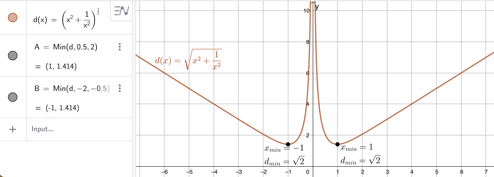

The $x$-coordinates of the minima are the $x$-coordinates of the points on $y=\Frac1x$ that are closest to the origin, and the $y$-coordinate of both minima, $\sqrt2$, is the smallest distance of such points from the origin.&nbsp; (In Calculus one learns how to show that $x=\pm1$ are the exact $x$-coordinates of the minima; but, having those values, it doesn’t require Calculus to determine what that minimum distance is: $d(\pm1) = \sqrt{(\pm1)^2 + \Frac1{(\pm1)^2}} = \sqrt{1 + 1} = \sqrt2.)$
  

<a name="6.6" class="goback" onclick="winhisback()">__6__</a>) 
A right triangle has one vertex on the graph of $y = 9 - x^2, x \gt 0$ at $(x,y)$; another at the origin; and the third on the positive $x$&#8209;axis at $(x,0)$; express the area $A$ of the triangle as a function of $x.$

__Sln__: Here’s a diagram of the situation: 

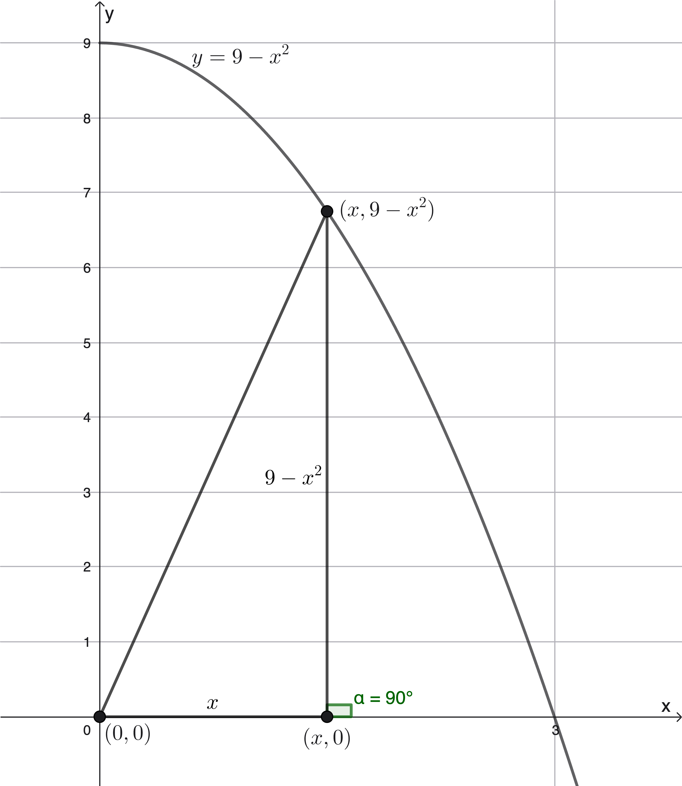

The area of a triangle is $\Frac12bh$ and in this situation $b = x, h = |9-x^2|$ (the absolute value being necessary because for $x \gt 3, 9-x^2 \lt 0$, but its magnitude still gives the &quot;height&quot; of the triangle).&nbsp; For $x \gt 0$ (as stipulated) $x = |x|$ so we have that: $$A(x) = \frac12|x||9-x^2| = \box{\frac{|9x-x^3|}2.}$$
 

<a name="6.12" class="goback" onclick="winhisback()">__12__</a>) 
__Geometry__ A wire 10 meters long is to be cut into two pieces: one piece will be shaped as an equilateral triangle, and the other piece will be shaped as a circle.&nbsp; __a__) Express the total area $A$ enclosed by the pieces of wire as a function of the length $x$ of a side of the equilateral triangle; __b__) what is the domain of $A(x)$? __c__) Graph $A = A(x)$; for what value of $x$ is $A$ smallest?

__Sln__: Here is a diagram of the situation:

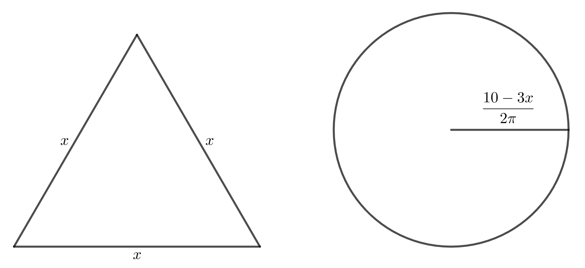

__a__) The required area is the sum of the area of the triangle, $\Frac{\sqrt3}4 x^2,$ and the area of the circle, $\pi r^2$; $r$ is determined using the fact that the circumference of a circle $C = 2\pi r \implies r = \Frac C{2\pi},$ and after three lengths of $x$ meters are used for the triangle, $10 - 3x$ meters are left for the circumference of the circle, so $r = \Frac{10-3x}{2\pi}.~$ Thus $$A(x) = \frac{\sqrt3}4 x^2 + \pi\left(\frac{10-3x}{2\pi}\right)^2 = \box{\frac{\pi\sqrt3 x^2 + 100-60x+9x^2}{4\pi} = \frac{(9+\pi\sqrt3)x^2 - 60x + 100}{4\pi}.}$$

__b__) As a purely abstract mathematical function, $A(x)$ is a polynomial, so the domain ___would___ be all real numbers; however, $x$ represents a length and thus can’t be less than zero, where $x=0$ corresponds to using the whole 10 meters of wire to make the circle; the other extreme is to use the whole 10 meters for the triangle, meaning $x \le \Frac{10}3.~$ So, depending on whether one interprets the instructions as ___must___ make both figures or ___may___ make both figures, the domain is either $\box{0 \lt  x \lt \frac{10}3\text{ or }0 \le  x \le \frac{10}3.}$ 
 

__c__) Here’s the required graph, including the domain restriction, the function minimum location, and the GeoGebra commands (left panel) required to generate it:

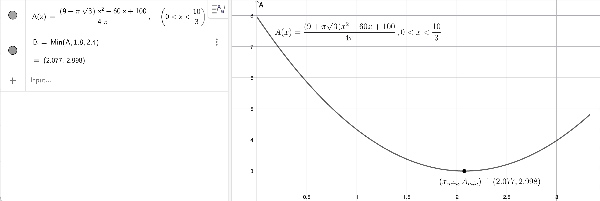

In Chapter 4 we learn how to find the minimum exactly, but for now we must use a graphing utility to do it.&nbsp; In GeoGebra, this is done using the `Min(<function>, <left bound>, <right bound>)` command, where `<function>` is the function whose minimum value we seek, `<left bound>` is a domain value to the left of the minimum (which the user must determine based on visual inspection of the graph) and `<right bound>` is a domain value to the right of the minimum, similarly identified.&nbsp; Using this method, we find that the $x$ for which $A(x)$ is &quot;smallest&quot; is approximately $\box{x \doteq 2.077\text{ meters}}$ and the smallest area is approximately $\box{A \doteq 2.998\text{ m^2}.}$ (Note that rounded to two decimal places this is 3.00, and GeoGebra, with the default rounding setting of two decimal places, will display this result as 3, which may deceive you into thinking that the minimum area is exactly 3; but when we learn how to find the exact minimum in Chapter 4, you will be able to see that this could not possibly be the case.)
  

<a name="6.18" class="goback" onclick="winhisback()">__18__</a>) 
__Uniform Motion__ Two cars leave an intersection at the same time (say, $t=0$); one is headed south at a constant speed of 30 miles per hour, the other is headed west at a constant speed of 40 miles per hour (see figure in the text, as well as the one below); build a model that expresses the distance $d$ between the cars as a function of the time $t$.

__Sln__: Since one car is moving due south and the other car is moving due west, their displacements from their common departure point form the legs of a right triangle whose hypotenuse is their distance from one another:

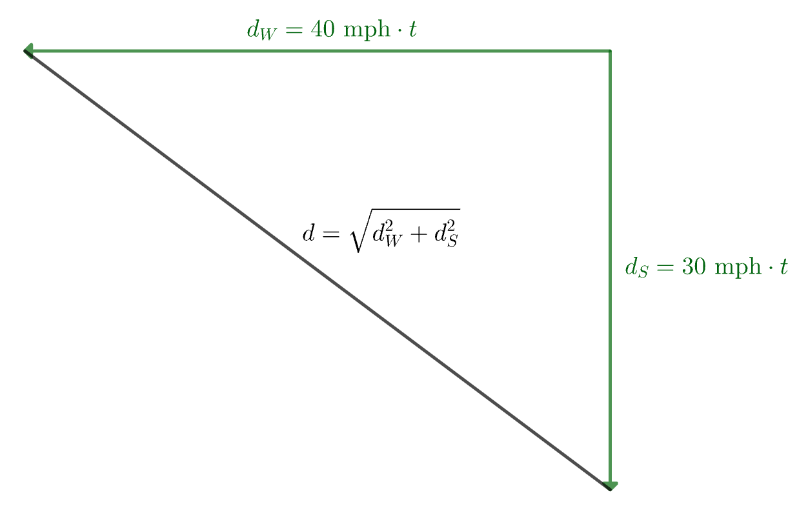

Measuring $t$ in hours, the length of the west-bound leg is $40t$ miles and the length of the south-bound leg is $30t$ miles; thus the straight-line distance between them is $d(t) = \sqrt{(40t)^2 + (30t)^2} = \sqrt{1600t^2 + 900t^2} = \sqrt{2500t^2} = \box{50t\text{ ft.}}$
  

<a name="6.24" class="goback" onclick="winhisback()">__24__</a>) 
__Filling a Conical Tank__ Water is poured into a container in the shape of a right circular cone with radius 4 feet and height 16 feet (vertical cross-section diagram below); express the volume $V$ of the water in the cone as a function of the height $h$ of the water.&nbsp; (Hint: The volume $V$ of a [right circular] cone of radius $r$ and height $h$ is $V = \Frac13\pi r^2h.$)

__Sln__: Technically, to solve this problem, we need to know a little elementary ___hydrostatics___&mdash;the physics of a fluid at rest&mdash;and recall the &quot;Angle-Angle&quot; theorem from geometry.&nbsp; The former tells us that the surface of the water will be parallel to the top of the cone (assuming the top of the cone is parallel to the ground where it is placed), and the latter tells us that, consequently, the ratio of the radius of the surface of the water $r$ to the depth of the water $h$ must equal the ratio of the total tank radius, 4, to the total tank height, 16; in symbols, $\Frac rh = \Frac4{16} = \Frac14$.&nbsp; Thus $r = \Frac h4 \implies V(h) = \Frac{\pi}3 r^2h = \Frac{\pi}3 \left(\Frac h4\right)^2h = \box{\frac{\pi}{48}h^3.}$

Here’s a digram: 

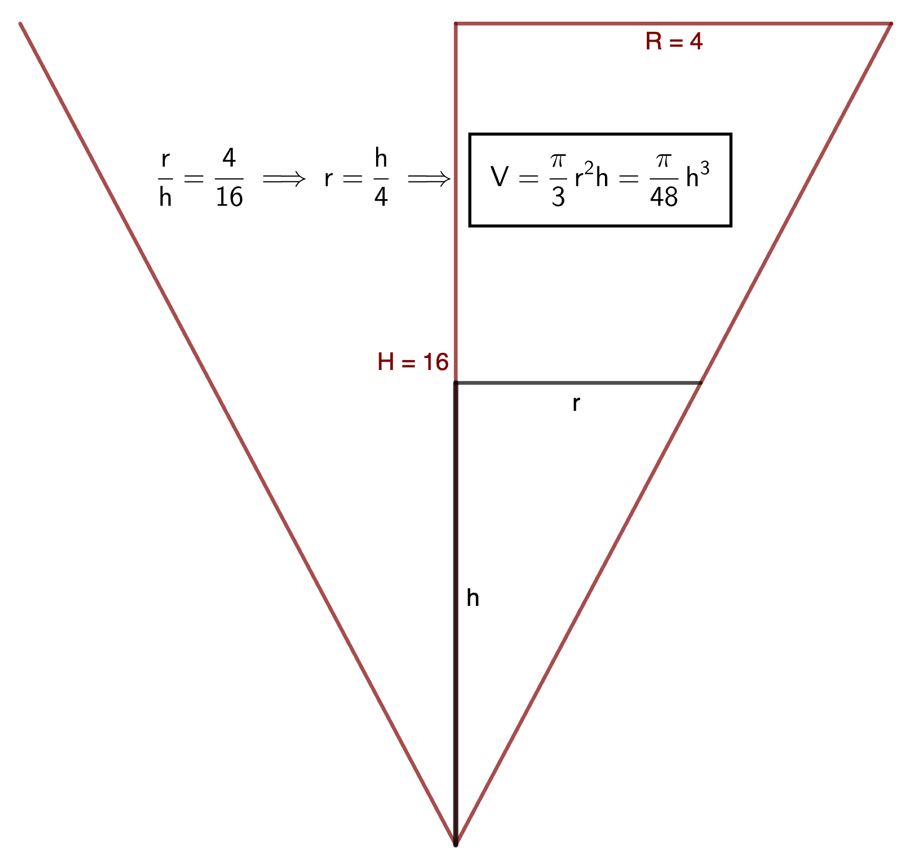

 

<a name="6.26" class="goback" onclick="winhisback()">__26__</a>) 
__Constructing an Open Box__ An open box with a square base is required to have a volume of 10 cubic feet: 
__a__) express the amount $A$ of material used to make such a box as a function of the length $x$ of a side of the square
base; __b__) how much material is required for a base 1 foot by 1 foot; __c__) how much material is required for a base 2 feet by
2 feet? __d__) use a graphing utility to graph $A = A(x)$; for what value of $x$ is $A$ smallest?

__Sln__: (Even though we consider it an important part of solving this problem, we leave drawing a picture of the situation to the reader.)

__a__) The volume $V$ of a box with a square base of edge length $x$ is $V = x^2h$ where $h$ is the height of the box, measured in the same units as the base edge length; given that $V=10,$ $h(x) = \Frac{10}{x^2}.~$ The box being open doesn’t affect the volume, but it does affect the area of material needed: we don’t need material for, presumably, the &quot;top,&quot; i.e., the face opposite its square bottom, so the area of material required is $A(x) = A_{\text{base}} + 4A_{\text{1 side}} = x^2 + 4xh =$ 
$$\box{x^2 + \frac{40}{x^2}.}$$
 

__b__ & __c__) Using the formula just derived, the amount of material required to build an open 10 cubic feet box with a base of 1 foot $\times$ 1 foot is $A(1) = 1^2 + \Frac{40}{1^2} = \box{41\text{ sq. ft.}}$, and the amount of material required for a 2’ $\times$ 2’ base box is $A(2) = 2^2 + \Frac{40}{2^2} = 4 + 10 = \box{14\text{ sq. ft.}}$
 

__d__) Using GeoGebra, first define the function we want to graph, as exhibited in the first command in the left panel of the figure below.&nbsp; Next, also as shown, use the name of the function in the `<function>` argument to the command `Min(<function>, <left bound>, <right bound>)`, where `<left bound>` is an $x$ value to the left of the minimum and `<right bound>` is an $x$ value on the right of the minimum.&nbsp; In this way we find that the base edge length which minimizes the amount of material required is approximately $\box{2.51\text{ ft}}$ and the resulting minimum area is $\box{12.65\text{ sq. ft.}}$

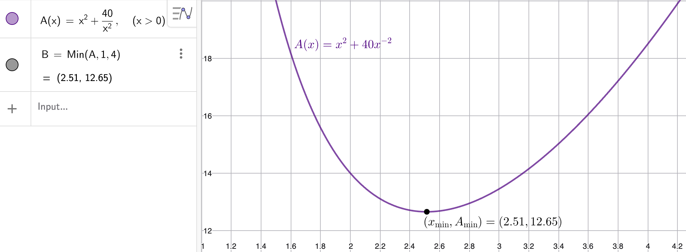

 

### Credits

Graphs generated using [GeoGebra](http://www.geogebra.org/).

### Please Donate:

<table>
  <tr>
    <td>
      <b>Venmo: @David-Goldsmith-13</b>
    </td>
    <td>
      <form action="https://www.paypal.com/cgi-bin/webscr"
            method="post"><input name="cmd"
            value="_xclick" type="hidden"> <input name="business"
            value="dgoldsmith_89@alumni.brown.edu" type="hidden"> <input
            name="item_name" value="SelectedSolutions Donation"
            type="hidden"> <input name="cn" value="Special Instructions
            (optional" type="hidden"> <input
            src="https://www.paypal.com/images/x-click-but04.gif"
            name="submit" alt="Make payments with PayPal - it's fast,
            free and secure!" align="middle" border="0" type="image"></form>
    </td>
  </tr>
</table>

