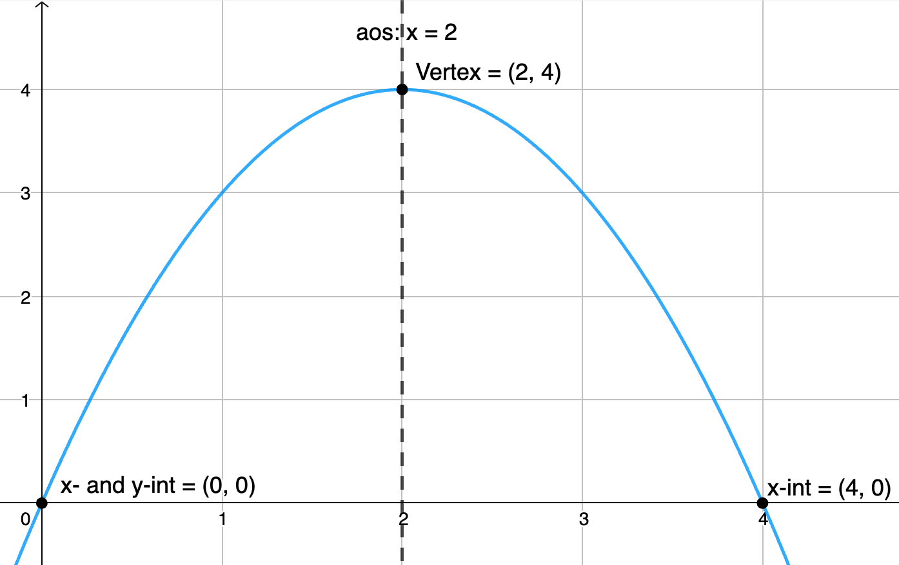
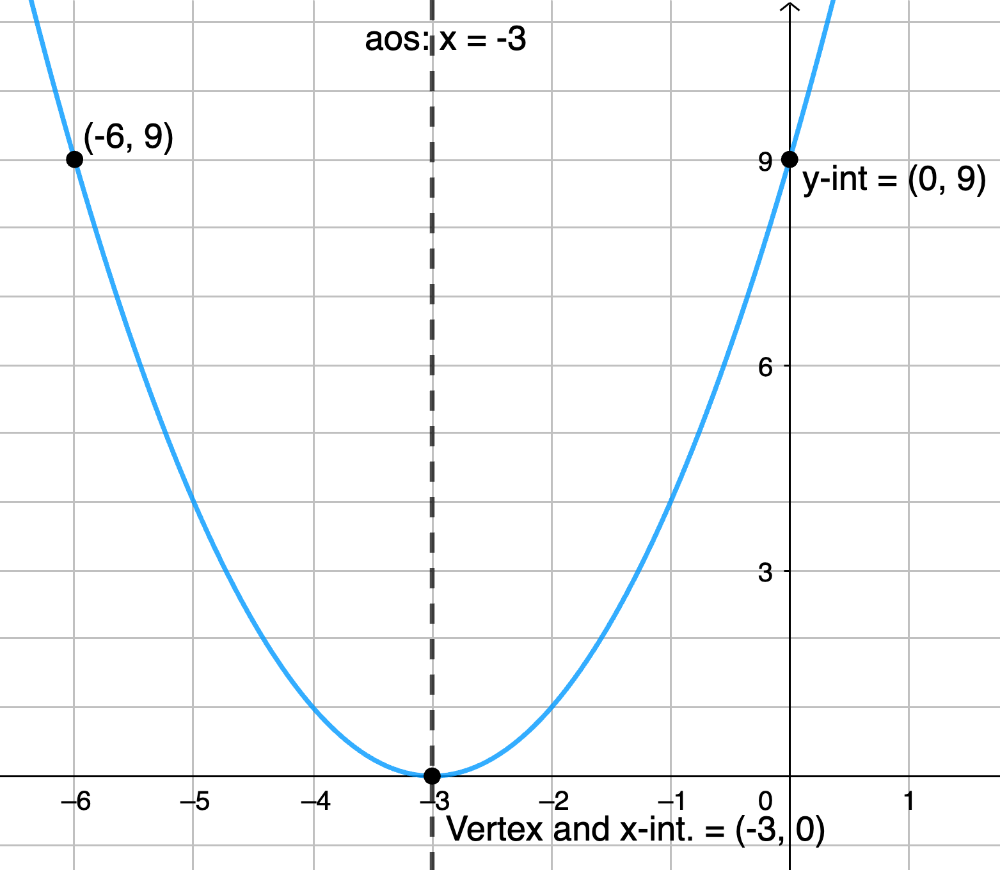
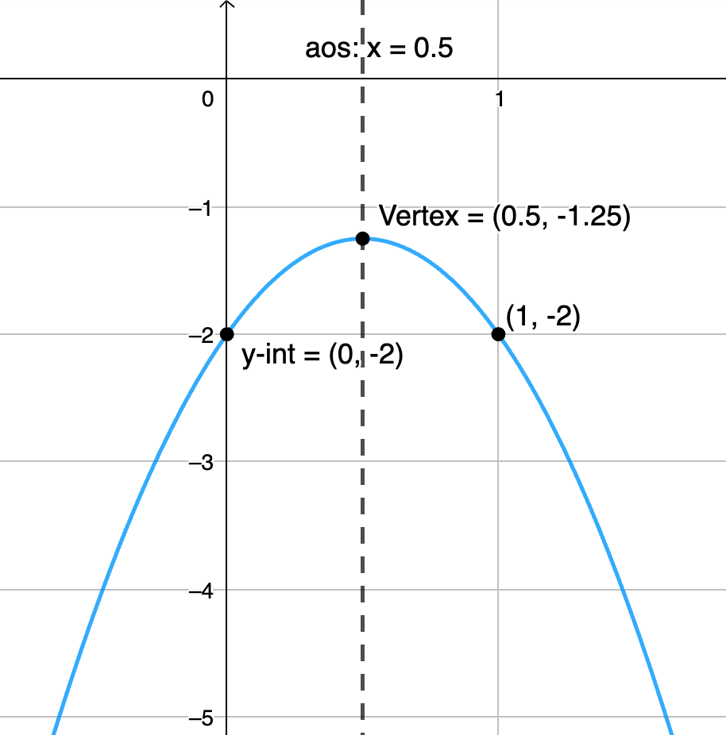
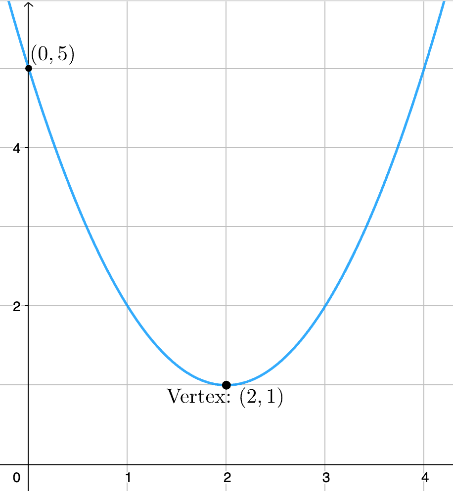
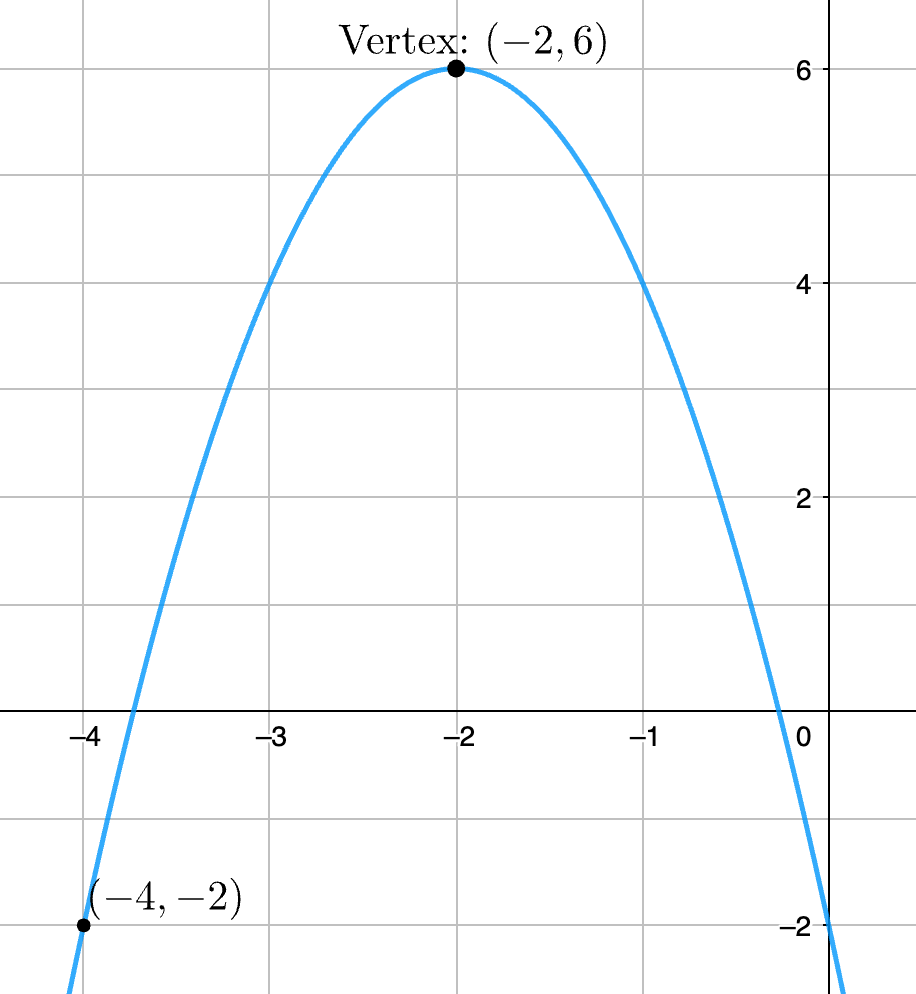

<link rel="stylesheet" href="../../Styles.css">
<title>Solutions of Selected Exercises from Sullivan, M. "Algebra & Trigonometry, 9th Ed. Chapter 4"</title>

$
\definecolor{red}{RGB}{255,0,0}
\definecolor{orange}{RGB}{245, 165, 0}
\definecolor{yellow}{RGB}{255,215,0}
\definecolor{green}{RGB}{0,255,0}
\definecolor{indigo}{RGB}{0,0,255}
\definecolor{violet}{RGB}{138,43,226}
\definecolor{black}{RGB}{0,0,0}
\newcommand{\a}{\alpha}
\newcommand{\b}{\beta}
\newcommand{\g}{\gamma}
\newcommand{\ds}{\displaystyle}
\newcommand{\Frac}{\displaystyle \frac}
\newcommand{\box}{\boxed}
\newcommand{\chec}{\checkmark}
\newcommand{\blksq}{\blacksquare}
\require{cancel}
$

## 
 Selected Exercise Solutions

from

### 
Sullivan, M., 2012. <i>Algebra & Trigonometry, Ninth Edition.</i> Prentice Hall, Boston
### 
Chapter 4: Linear and Quadratic Functions
### 
&copy; 2026 by
### 
[David Lawrence Goldsmith](https://www.linkedin.com/in/olydlg)

for

## 
[SelectedSolutionsDotNet](https://olydlg.github.io/selectedsolutionsdotnet/)

<i>Notes:  These solutions are provided &quot;as-is,&quot; for informational purposes only, with no warranty of any kind, expressed or implied, including that of correctness, adequacy, and/or suitability for any purpose, whatsoever.</i> Corrections are welcome and should be emailed to selectedsolutionsdotnet@gmail.com.

Purple font indicates clicking on the text will return you to your prior place; a $\blksq$ marks the end of a proof.
 

### Contents

<table>
  <tr>
   <th colspan=11>Section 1: Linear Functions and Their Properties</th>
  </tr>
  <tr>
    <td><a href="#1.16">1.16</a></td>
  </tr>
  <tr>
  </tr>
  <tr>
   <th colspan=10>Section 2: Linear Models: Building Linear Functions from Data</th>
  </tr>
  <tr>
    <td><a href="#2.6">2.6</a></td>
  </tr>
  <tr>
   <th colspan=10>Section 3: Quadratic Functions and Their Properties</th>
  </tr>
  <tr>
    <td><a href="#3.70">3.70</a></td>  
    <td><a href="#3.34">3.34</a></td>
    <td><a href="#3.38">3.38</a></td>
    <td><a href="#3.42">3.42</a></td>
    <td><a href="#3.46">3.46</a></td>
    <td><a href="#3.48">3.48</a></td>
    <td><a href="#3.52">3.52</a></td>
    <td><a href="#3.56">3.56</a></td>
    <td><a href="#3.58">3.58</a></td>
    <td><a href="#3.62">3.62</a></td>
  </tr>
  <tr>
    <td><a href="#3.64">3.64</a></td>
    <td><a href="#3.68">3.68</a></td>  
    <td><a href="#3.74">3.74</a></td>
    <td><a href="#3.78">3.78</a></td>  
    <td><a href="#3.84">3.84</a></td>  
    <td><a href="#3.85">3.85</a></td>
    <td><a href="#3.89">3.89</a></td>
    <td><a href="#3.92">3.92</a></td>
  </tr>
  <tr>
   <th colspan=10>Section 4: Building Quadratic Models from Verbal Descriptions and from Data</th>
  </tr>
  <tr>
    <td><a href="#4.32">4.32</a></td>
  </tr>
  <tr>
   <th colspan=11>Section 5: Inequalities Involving Quadratic Functions</th>
  </tr>
  <tr>
    <td><a href="#5.20">5.20</a></td>
  </tr>
</table>

## Section 1: Linear Functions and Their Properties

  

## Section 2: Linear Models: Building Linear Functions from Data

  

## Section 3: Quadratic Functions and Their Properties

<a name="3.70" class="goback" onclick="winhisback()">__3.70__</a>)
__a__) Find a quadratic function whose $x$-intercepts are $-5$ and $3$ with $a=1; 2; -2;$ and $5$; how does the value of $a$ affect: __b__) the intercepts; __c__) the axis of symmetry; __d__) the vertex? __e__) Compare the $x$-coordinate of the vertex with the
midpoint of the $x$-intercepts: what might you conclude?

__Sln__: We put this one first, i.e., out of numerical order, because, in our opinion, it is the most important Problem in the entire set, and we will use the result of Part e repeatedly, because one can (and should, in our opinion) use it to find the axis of symmetry and thus the vertex and thus the vertex form of the quadratic function, without having to complete the square (indeed, the result of Part e gives us a much easier way of completing the square than the &quot;direct&quot; method).&nbsp; Additionally, although the text restricts the discussion to when the zeros of the quadratic are real, the relationship between the zeros and the axis of symmetry (and thus the $x$-coordinate of the vertex and vertex form of the quadratic) is true even when the zeros are complex, as long as the coefficients $a,b,c$ are real.&nbsp; Thus using the result of Part e should be the way one analyzes all quadratics with real coefficients, and this is the way we will be solving all the other Problems.

__a__) ___By definition___, the $x$-intercepts of the graph of any relation (not just functions) are those points where the $y$-coordinate is zero; so being told that the $x$-intercepts are $-5$ and $3$, we know that $a(-5)^2 + b(-5) + c = 0$ and $a(3)^2 + b(3) + c = 0.~$ For $a = 1$ this gives the simultaneous linear equations $25 - 5b + c = 0$ and $9 + 3b + c = 0 \implies$ (eliminating $c$) $5b - 25 = -3b - 9$ $\implies 8b = 16$ $\implies b = 2$ $\implies c = -15$ for a result of $\box{f(x) = x^2 + 2x - 15}$ for $a=1.~$ Similarly, $a = 2 \implies$ $2(-5)^2 + b(-5) + c = 0 = 2(3)^2 + b(3) + c$ $\implies 8b = 32$ $\implies b = 4$ $\implies c = -30$ $\implies \box{f(x) = 2x^2 + 4x - 30}$; $a = -2 \implies$ $-2(-5)^2 + b(-5) + c = 0 = -2(3)^2 + b(3) + c$ $\implies 8b = -32$ $\implies b = -4$ $\implies c = 30$ $\implies \box{f(x) = -2x^2 - 4x + 30}$; and $a = 5 \implies$ $5(-5)^2 + b(-5) + c = 0 = 5(3)^2 + b(3) + c$ $\implies 8b = 80$ $\implies b = 10$ $\implies c = -75$ $\implies \box{f(x) = 5x^2 + 10x - 75}.~$ (It should be clear from the answers that they &quot;check&quot; for the required values of $a$; the check that each of them has the required $x$-intercepts is left to the reader.)
 

__b__) It doesn’t: the value of $a$ is completely independent of the $x$-intercepts&mdash;___given any pair of $x$-intercepts (which, in general, may be equal to one another), one may choose any value of $a$ without affecting those intercepts___ (it affects every other point on the graph, but not the $x$-intercepts).
 

__c__) $a = 1 \implies x = -\Frac b{2a} = -\Frac2{2(1)} = -1$; $a = 2 \implies x = -\Frac{4}{2(2)} = -1$; $a = -2 \implies x = -\Frac{-4}{2(-2)} = -1$; $a = 5 \implies x = -\Frac{10}{2(5)} = -1$: it certainly appears as if the value of $a$ also doesn’t affect the axis of symmetry.
 

__d__) $-\Frac b{2a}$ is also the $x$-coordinate of the vertex, so that is also $-1$ for all four of these parabolas; however, the value of $f(-1)$ is different for each of them: $a=1: f(-1) = (-1)^2 + 2(-1) - 15 = -16$ $\implies \box{\text{vertex}=(-1,-16)}$; $a=2: f(-1) = 2(-1)^2 + 4(-1) - 30 = -32$ $\implies \box{\text{vertex}=(-1,-32)}$; $a=-2: f(-1) = -2(-1)^2 - 4(-1) + 30 = 32$ $\implies \box{\text{vertex}=(-1,32)}$; and, based on the pattern, we predict that for $a=5, f(-1) = 5(-16) = -80 = 5(-1)^2 + 10(-1) - 75~\chec$ so $\box{\text{vertex}=(-1,-80)}.$ (In other words, this suggests that if $(x,y)$ is the vertex for $a=1$, then if another parabola has the same $x$-intercepts but leading coefficient $a \ne 1$, then its vertex will be at $(x, ay).$) 
 

__e__) The $x$-coordinate of the midpoint of the $x$-intercepts is their arithmetic average, i.e., one-half their sum: $\Frac12(-5 + 3) = -1$ which is also the $x$-coordinate of the vertex, which is also the value of $x$ for the axis of symmetry...but is this always true?&nbsp; Let’s see: if the graph has $x$-intercepts, they are where $f(x) = ax^2 + bx + c = 0 \implies x = \Frac{-b + \sqrt{b^2-4ac}}{2a}$ is the $x$-coordinate of one of them and $x = \Frac{-b - \sqrt{b^2-4ac}}{2a}$ is the $x$-coordinate of the other; adding these together and multiplying by $\Frac12$ gives: $$\frac12\frac{-b + \cancel{\sqrt{b^2-4ac}} + (-b - \cancel{\sqrt{b^2-4ac}})}{2a} = \frac{-2b}{4a} = -\frac b{2a}$$
exactly the value of the $x$-coordinate of the vertex and the value $x$ equals for the axis of symmetry: ___the $x$-coordinate of the vertex $=$ the value of $x$ for the axis of symmetry, is half the sum of the zeros of the quadratic___ (this is true even if the zeros are complex: in that case, the parabola has no $x$-intercepts, but it still has an axis of symmetry and a vertex, and the former and the $x$-coordinate of the latter are still given by the average of the (complex) zeros).&nbsp; So, if you’re given the zeros of a quadratic&mdash;be it explicitly, as in this problem; graphically; or implicitly, e.g., because the quadratic is given in factored form, $f(x) = a(x - r)(x - s) \implies r$ and $s$ are the zeros&mdash;you can use this fact to quickly determine the axis of symmetry and $x$-coordinate of the vertex without first having to obtain $b$; and once you’ve determined the $x$&#8209;coordinate this way, you can plug that into the factored form to get the $y$-coordinate of the vertex, from which you can immediately write down the vertex form of the quadratic, which is equivalent to completing its square, without ever having to go through the $f(x) = ax^2 + bx +c$ form of the equation.&nbsp; Let me repeat that: ___you never really have to complete the square the hard way___, you can always find the vertex from the zeros, write the vertex form of the quadratic, and that is the completed the square form of the quadratic. 
  

__34__, __38__, __42__, __46__) State: whether the given function opens up or down; its vertex; its axis of symmetry (aos); its intercepts (state &quot;no $x$-intercepts&quot; if that is the case); its domain and range; and the intervals over which it is increasing and decreasing; and use this information to label a graph of the function.

__Sln__: There are two questions about quadratic functions&mdash;all polynomial functions, really&mdash;you should never have to think about and should never get wrong: 1) the $y$-intercept; and 2) the domain.&nbsp; The $x$-coordinate of the $y$-intercept is always 0 ___by definition___, and consequently the $y$-coordinate is always the constant term (which is zero if it is &quot;missing&quot;).&nbsp; The domain is always &quot;all real numbers&quot; $=\mathbb{R} = (-\infty,\infty)$; this is because the operations in polynomials&mdash;addition, subtraction, multiplication, raising to a non-negative integer power&mdash;are well-defined for all real numbers: polynomials don’t try to do things to real numbers that can’t be done to them.&nbsp; (Trying to do certain things to some real numbers&mdash;division by zero; taking an even root of a negative number; taking a logarithm of a non-positive number&mdash;are the primary things that result in domains other than &quot;all real numbers.&quot;)
 

<a name="3.34" class="goback" onclick="winhisback()">__3.34__</a>)
$f(x) = -x^2 + 4x$

__Sln__: $f(x) = ax^2 + bx + c$ with $a = -1, b = 4, c = 0$; $a \lt 0 \implies$ the graph $\box{\text{opens down}}$; $-\Frac4{2(-1)} = 2 \implies \box{x = 2}$ is the aos and $f(2) = -(2)^2 + 4(2) = 4 \implies \box{\text{vertex}=(2,4)}$; the $\box{y\text{-intercept}= (0,0)}$ and since the $y$-coordinate of this point is 0, $\box{\text{it is an }x\text{-intercept}}$ as well, but it is not the only one: $-x^2 + 4x = -x(x - 4) = 0 \implies x=4$ is another zero of $f$ so $\box{(4,0)}$ is the other $x$-intercept (remember that a parabola has not more than two $x$-intercepts, so if we have found two, we stop looking for more).&nbsp; The $\box{\text{domain}= \mathbb{R}},$ the $\box{\text{range}=(-\infty, 4]},$ $f$ is $\box{\text{increasing on }(-\infty, 2)}$ and $\box{\text{decreasing on }(2, \infty)}.~$ Here’s a labeled graph:

 

<a name="3.38" class="goback" onclick="winhisback()">__3.38__</a>)
$f(x) = x^2 + 6x + 9$

__Sln__: $a = 1 \gt 0 \implies \box{\text{opens up}}$; $c = 9 \implies \box{y\text{-intercept}=(0,9)}$; $b = 6 \implies -\Frac b{2a} = -\Frac6{2(1)} = -3 \implies$ $\box{\text{aos: } x = -3}$; $(-3)^2 + 6(-3) + 9 = 0 \implies \box{\text{vertex}=(-3,0)}$; $x^2 + 6x + 9 = (x+3)^2 = 0 \implies \box{x\text{-int.}=(-3,0)}$ as well (and this is the only $x$-intercept); $\box{\text{dom.} = \mathbb{R}, \text{ran.}=[0,\infty), \text{incr.}=(-3,\infty), \text{decr.}=(-\infty,-3).\!\!\!\!\!\!\!\!\!}$&nbsp; Here’s a labeled graph:

 

<a name="3.42" class="goback" onclick="winhisback()">__3.42__</a>)
$f(x) = -3x^2 + 3x - 2$

__Sln__: $a = -3 \lt 0 \implies \box{\text{opens down}}$; $c = -2 \implies \box{y\text{-int.}=(0,-2)}$; $b = 3 \implies -\Frac b{2a} = -\Frac3{2(-3)} = \Frac12 \implies \box{\text{aos: }x=\frac12}$; $-3\left(\Frac12\right)^2 + 3\left(\Frac12\right) - 2 = -\Frac34 + \Frac32 - 2 = -\Frac54 \implies \box{\text{vert.}=\left(\frac12,-\frac54\right)}$; down opening and a vertex below the $x$-axis $\implies \box{\text{no }x\text{-intercepts}}$ (check: $b^2 - 4ac = 9 - 4(-3)(-2) = -15 \lt 0~\chec$); $\box{\text{dom.} = \mathbb{R}, \text{ran.}=\left(-\infty,-\frac54\right], \text{incr.}=\left(-\infty,\frac12\right), \text{decr.}=\left(\frac12,\infty\right).\!\!\!\!\!\!\!\!\!}$&nbsp; Here’s a labeled graph:

 

<a name="3.46" class="goback" onclick="winhisback()">__3.46__</a>)
$f(x) = 3x^2 - 8x + 2$

__Sln__:
  

__48__, __52__) Determine the quadratic function whose graph is given.

<a name="3.48" class="goback" onclick="winhisback()">__3.48__</a>)

__Sln__:
  

<a name="3.52" class="goback" onclick="winhisback()">__3.52__</a>)

__Sln__:
  

__56__, __58__) __Without graphing__, state whether the given function has a maximum or a minimum value and then find that value.

<a name="3.56" class="goback" onclick="winhisback()">__3.56__</a>)
$f(x) = 4x^2 - 8x + 3$

__Sln__:
  

<a name="3.58" class="goback" onclick="winhisback()">__3.58__</a>)
$f(x) = -2x^2 + 8x + 3$

__Sln__:
  

<a name="3.62" class="goback" onclick="winhisback()">__3.62__</a>)
The graph of $f(x) = ax^2 + bx + c$ has vertex at $(1, 4)$ and passes through the point $(-1, -8)$: find $a, b,$ and $c.$

__Sln__:
  

__64__, __68__) Given each pair of functions, $f(x)$ and $g(x)$: __b__) Solve $f(x) = g(x)$; __a__ and __c__) graph $f,g$ on the same set of axes and use the result of Part b to label the points of intersection; __d__) shade the region $f(x) \gt g(x).$

<a name="3.64" class="goback" onclick="winhisback()">__3.64__</a>)
$f(x) = -2x - 1;~g(x) = x^2 - 9$

__Sln__:
  

<a name="3.68" class="goback" onclick="winhisback()">__3.68__</a>)
$f(x) = -x^2 + 7x - 6;~g(x) = x^2 + x - 6$

__Sln__:
  

<a name="3.74" class="goback" onclick="winhisback()">__3.74__</a>)
What point on the line $y = x + 1$ is closest to the point $(4,1)$?

__Sln__:
  

<a name="3.78" class="goback" onclick="winhisback()">__3.78__</a>)
The marginal cost $C$ (in dollars; see Problem 77 in the text for the definition, which we don’t need to be able to answer these questions) of manufacturing $x$ cell phones (in thousands) is given by $$C(x) = 5x^2 - 200x + 4000.$$

How many cell phones should be manufactured to minimize the marginal cost, and what is the resulting minimum $C$?

__Sln__:
  

<a name="3.84" class="goback" onclick="winhisback()">__3.84__</a>)
Find a quadratic function whose $x$-intercepts are and $-1$ and $5$ and whose range is $(-\infty, 9]$.

__Sln__:
  

<a name="3.85" class="goback" onclick="winhisback()">__3.85__</a>)
Let $f(x) = ax^2 + bx +c$ where $a,b,c$ are odd integers; show that if $x$ is an odd integer then $f(x)$ must be an odd integer.

__Pf__:
  

<a name="3.89" class="goback" onclick="winhisback()">__3.89__</a>)
Under what circumstances does the graph of $f(x) = ax^2 + bx + c$ have no $x$-intercepts?

__Sln__:
  

<a name="3.92" class="goback" onclick="winhisback()">__3.92__</a>)
What are the possibilities for the number of times the graphs of two different quadratic functions (with real coefficients) intersect?

__Sln__: Given two quadratic functions, $f(x) = Ax^2 + Bx + C,~g(x) = ax^2 + bx + c,$ with real coefficients, their graphs intersect where $f(x) = g(x) \implies Ax^2 + Bx + C = ax^2 + bx + c \implies (A-a)x^2 + (B-b)x + (C-c) = 0.~$ If $A = a$, this $\implies (B-b)x + (C-c) = 0$; if also $B=b$ then, since it is stipulated that the functions are different, $C \ne c \implies C-c \ne 0 \implies$ $\box{\text{no points of intersection}}$ in the case $A = a, B = b, C \ne c.~$ Continuing with the case $A = a,$ if $B \ne b$ then, regardless of whether or not $C = c,$ $x = -\Frac{C-c}{B-b}$ is well-defined and unique, implying $\box{\text{one point of intersection}}$ in this case of $A = a, B \ne b.~$ If $A \ne a$, then, letting $\a = A-a, \b = B-b, \g = C-c,$ the quadratic $(A-a)x^2 + (B-b)x + (C-c) = \a x^2 + \b x + \g$ has zero, one, or two real solutions depending on whether $\b^2 - 4\a\g$ is less than, equal to, or greater than zero, respectively.&nbsp; Thus the possibilities are $\box{\text{zero, one, or two}}$ points of intersection, with two different ways each in which the result might be zero or one point of intersection.&nbsp; (The reader is &quot;strongly encourged&quot; to figure out the geometry of each of the cases above; for example, the case $A = a, B = b, C \ne c$ corresponds to two otherwise-identical parabolas, vertically displaced relative to one another: they do not intersect precisely because they &quot;start off&quot; from different vertical positions at the same $x$-coordinate, but are otherwise identical and thus always remain the same vertical distance from one another; the reader should similarly figure out the geometry of the cases $A=a, B \ne b;$ $A \ne a, \b^2 - 4\a\g \lt; =; \gt 0.$)
  

## Section 4: Build Quadratic Models from Verbal Descriptions and from Data

  

## Section 5: Inequalities Involving Quadratic Functions

  

### Credits

Graphs generated using [GeoGebra](http://www.geogebra.org/).

### Please Donate:

<table>
  <tr>
    <td>
      <b>Venmo: @David-Goldsmith-13</b>
    </td>
    <td>
      <form action="https://www.paypal.com/cgi-bin/webscr"
            method="post"><input name="cmd"
            value="_xclick" type="hidden"> <input name="business"
            value="dgoldsmith_89@alumni.brown.edu" type="hidden"> <input
            name="item_name" value="SelectedSolutions Donation"
            type="hidden"> <input name="cn" value="Special Instructions
            (optional" type="hidden"> <input
            src="https://www.paypal.com/images/x-click-but04.gif"
            name="submit" alt="Make payments with PayPal - it's fast,
            free and secure!" align="middle" border="0" type="image"></form>
    </td>
  </tr>
</table>

