

<link rel="stylesheet" href="../../Styles.css">
<title>Solutions of Selected Exercises from Sullivan, M. "Algebra & Trigonometry, 9th Ed. Chapter 5"</title>

$
\definecolor{red}{RGB}{255,0,0}
\definecolor{orange}{RGB}{245, 165, 0}
\definecolor{yellow}{RGB}{255,215,0}
\definecolor{green}{RGB}{0,255,0}
\definecolor{indigo}{RGB}{0,0,255}
\definecolor{violet}{RGB}{138,43,226}
\definecolor{black}{RGB}{0,0,0}
\newcommand{\ds}{\displaystyle}
\newcommand{\Frac}{\displaystyle \frac}
\newcommand{\box}{\boxed}
\newcommand{\chec}{\checkmark}
\newcommand{\blksq}{\blacksquare}
\require{cancel}
$

## 
 Selected Exercise Solutions

from

### 
Sullivan, M., 2012. <i>Algebra & Trigonometry, Ninth Edition.</i> Prentice Hall, Boston
### 
Chapter 5: Polynomial and Rational Functions
### 
&copy; 2026 by
### 
[David Lawrence Goldsmith](https://www.linkedin.com/in/olydlg)

for

## 
[SelectedSolutionsDotNet](https://olydlg.github.io/selectedsolutionsdotnet/)

<i>Notes:  These solutions are provided &quot;as-is,&quot; for informational purposes only, with no warranty of any kind, expressed or implied, including that of correctness, adequacy, and/or suitability for any purpose, whatsoever.</i> Corrections are welcome and should be emailed to selectedsolutionsdotnet@gmail.com.

Purple font indicates clicking on the text will return you to your prior place; a $\blksq$ marks the end of a proof.
 

### Contents

<table>
  <tr>
   <th colspan=11>Section 1: Polynomial Functions and Models</th>
  </tr>
  <tr>
    <td><a href="#1.20">1.20</a></td>
    <td><a href="#1.22">1.22</a></td>
    <td><a href="#1.24">1.24</a></td>
    <td><a href="#1.26">1.26</a></td>
    <td><a href="#1.44">1.44</a></td>
    <td><a href="#1.48">1.48</a></td>
    <td><a href="#1.52">1.52</a></td>
    <td><a href="#1.56">1.56</a></td>
    <td><a href="#1.60">1.60</a></td>
    <td><a href="#1.62">1.62</a></td>
    <td><a href="#1.64">1.64</a></td>
  </tr>
  <tr>
    <td><a href="#1.68">1.68</a></td>
    <td><a href="#1.74">1.74</a></td>
    <td><a href="#1.80">1.80</a></td>
    <td><a href="#1.86">1.86</a></td>
    <td><a href="#1.90">1.90</a></td>
    <td><a href="#1.94">1.94</a></td>
    <td><a href="#1.98">1.98</a></td>
    <td><a href="#1.102">1.102</a></td>
    <td><a href="#1.106">1.106</a></td>
    <td><a href="#1.114">1.114</a></td>
    <td><a href="#1.118">1.118</a></td>
  </tr>
  <tr>
   <th colspan=11>Section 2: Properties of Rational Functions</th>
  </tr>
  <tr>
    <td><a href="#2.6">2.6</a></td>
    <td><a href="#2.8">2.8</a></td>
    <td><a href="#2.10">2.10</a></td>
    <td><a href="#2.12">2.12</a></td>
    <td><a href="#2.18">2.18</a></td>
    <td><a href="#2.20">2.20</a></td>
    <td><a href="#2.22">2.22</a></td>
  </tr>
  <tr>
    <td><a href="#2.24">2.24</a></td>
    <td><a href="#2.46">2.46</a></td>
    <td><a href="#2.50">2.50</a></td>
    <td><a href="#2.54">2.54</a></td>
    <td><a href="#2.56">2.56</a></td>
    <td><a href="#2.61">2.61</a></td>
  </tr>
  <tr>
   <th colspan=10>Section 3: The Graph of a Rational Function</th>
  </tr>
  <tr>
    <td><a href="#3.8">3.8</a></td>
    <td><a href="#3.14">3.14</a></td>
    <td><a href="#3.20">3.20</a></td>
    <td><a href="#3.26">3.26</a></td>
    <td><a href="#3.32">3.32</a></td>
    <td><a href="#3.38">3.38</a></td>
    <td><a href="#3.44">3.44</a></td>
    <td><a href="#3.48">3.48</a></td>
    <td><a href="#3.54">3.54</a></td>
  </tr>
  <tr>
   <th colspan=10>Section 4: Polynomial and Rational Inequalities</th>
  </tr>
  <tr>
    <td><a href="#4.8">4.8</a></td>
    <td><a href="#4.14">4.14</a></td>
    <td><a href="#4.18">4.18</a></td>
    <td><a href="#4.24">4.24</a></td>
    <td><a href="#4.30">4.30</a></td>
    <td><a href="#4.36">4.36</a></td>
    <td><a href="#4.42">4.42</a></td>
  </tr>
  <tr>
    <td><a href="#4.48">4.48</a></td>
    <td><a href="#4.54">4.54</a></td>
    <td><a href="#4.60">4.60</a></td>
    <td><a href="#4.66">4.66</a></td>
    <td><a href="#4.70">4.70</a></td>
    <td><a href="#4.74">4.74</a></td>
  </tr>
  <tr>
   <th colspan=10>Section 5: The Real Zeros of a Polynomial Function</th>
  </tr>
  <tr>
    <td><a href="#5.14">5.14</a></td>
    <td><a href="#5.20">5.20</a></td>
    <td><a href="#5.26">5.26</a></td>
    <td><a href="#5.32">5.32</a></td>
    <td><a href="#5.38">5.38</a></td>
    <td><a href="#5.44">5.44</a></td>
    <td><a href="#5.48">5.48</a></td>
    <td><a href="#5.52">5.52</a></td>
    <td><a href="#5.56">5.56</a></td>
  </tr>
  <tr>
    <td><a href="#5.60">5.60</a></td>
    <td><a href="#5.64">5.64</a></td>
    <td><a href="#5.68">5.68</a></td>
    <td><a href="#5.74">5.74</a></td>
    <td><a href="#5.80">5.80</a></td>
    <td><a href="#5.96">5.96</a></td>
    <td><a href="#5.102">5.102</a></td>
    <td><a href="#5.108">5.108</a></td>
    <td><a href="#5.112">5.112</a></td>
  </tr>
  <tr>
   <th colspan=10>Section 6: Complex Zeros; Fundamental Theorem of Algebra</th>
  </tr>
  <tr>
    <td><a href="#6.6">6.6</a></td>
    <td><a href="#6.10">6.10</a></td>
    <td><a href="#6.16">6.16</a></td>
    <td><a href="#6.22">6.22</a></td>
    <td><a href="#6.26">6.26</a></td>
    <td><a href="#6.28">6.28</a></td>
    <td><a href="#6.30">6.30</a></td>
    <td><a href="#6.32">6.32</a></td>
    <td><a href="#6.36">6.36</a></td>
    <td><a href="#6.40">6.40</a></td>
  </tr>
</table>

## Section 1: Polynomial Functions and Models

__20__, __22__, __24__, __26__) State whether or not the given function is a polynomial (in $x$); if it is, state its degree; if it is not, state why it isn’t.

<a name="1.20" class="goback" onclick="winhisback()">__1.20__</a>)
$f(x) = x(x-1)$

__Sln__: In determining whether or not an expression is or isn’t a polynomial, as well as its degree, what’s important is not whether or not the expression is ___given to us___ in polynomial form, but whether or not it ___can be___ expressed in polynomial form.&nbsp; Thus because $x(x-1) = x^2 - x,$ which is of polynomial form, $\box{f(x)\text{ is a polynomial}}$ and its degree is $\box{2.}$ 
  

<a name="1.22" class="goback" onclick="winhisback()">__1.22__</a>)
$h(x) = \sqrt{x}(\sqrt{x} - 1)$

__Sln__: $\sqrt{x}(\sqrt{x} - 1) = (\sqrt{x})(\sqrt{x}) - \sqrt{x} = x - \sqrt{x} = x^1 - x^{1/2}$; since one of $x$’s exponents, $\Frac12$, is not a non-negative integer, $\box{h(x)\text{ is not a polynomial}}$ (in $x$).
  

<a name="1.24" class="goback" onclick="winhisback()">__1.24__</a>)
$F(x) = \Frac{x^2 - 5}{x^3}$

__Sln__: $\Frac{x^2 - 5}{x^3} = \Frac{x^2}{x^3} - \Frac5{x^3} = x^{-1} - 5x^{-3}$; since even just one of the $x$’s exponents is a negative integer, $\box{F(x)\text{ is not a polynomial}}$ (in $x$).
  

<a name="1.26" class="goback" onclick="winhisback()">__1.26__</a>)
$G(x) = -3x^2(x+2)^3$

__Sln__: $-3x^2(x+2)^3 = -3x^2(x^3 + 3(2^1)x^2 + 3(2^2)x^1 + 2^3) = -3x^5 - 18x^4 - 36x^3 - 24x^2$; since all of the $x$’s exponents are non-negative integers, $\box{G(x)\text{ is a polynomial}}$ and its degree is $\box{5.}$
  

__44__, __48__) Form a polynomial function whose real zeros and degree are given.

<a name="1.44" class="goback" onclick="winhisback()">__1.44__</a>)
Zeros: $-4, 0, 2$; degree 3

__Sln__: $f(x) = a(x - (-4))(x - 0)(x - 2) = ax(x+4)(x-2) = ax(x^2 + 2x - 8) = ax^3 + 2ax^2 - 8ax$ is a degree-three polynomial for any $a \ne 0$; to show that it has the required zeros, use its factored form: $f(-4) = a(-4 - (-4))(-4)(-4 - 2) = a(0)(-4)(-6) = 0$ and similarly for $f(0)$ and $f(2).$ 
  

<a name="1.48" class="goback" onclick="winhisback()">__1.48__</a>)
Zeros: $-2,$ multiplicity 2; 4, multiplicity 1; degree 3
 
__Sln__: $g(r) = c(r - (-2))(r - (-2))(r - 4) = c(r + 2)^2(r - 4) = c(r^2 + 4r + 4)(r - 4) = c(r^3 + \cancel{4r^2} + 4r - \cancel{4r^2} - 16r - 16) = cr^3 - 12cr - 16c$ is a degree-three polynomial function of $r$ for any $c \ne 0$; for any such $c$, the facts that $g(-2) = c(-2)^3 -12c(-2) - 16c = c(-8 + 24 - 16) = 0$ and $g(4) = c(4^3) - 12c(4) - 16c = c(64 - 48 - 16) = 0$ show that it has the required zeros; and the factorization $g(r) = c(r+2)^2(r-4)$ shows that these zeros have the required multiplicities.
  

__52__, __56__, __60__) For the given polynomial function: __a__) list each real zero and its multiplicity; __b__) state whether its graph crosses or &quot;grazes&quot; (just touches) the $x$-axis at each $x$-intercept; __c__) state the behavior of its graph near each $x$-intercept; __d__) state the maximum number of turning points of its graph; __e__) state its end behavior, i.e., state what power function its graph approaches for large values of $|x|.$

<a name="1.52" class="goback" onclick="winhisback()">__1.52__</a>)
$f(x) = 2(x - 3)(x^2 + 4)^3$

__Sln__: __a__) $f(x) = 2(x - 3)(x^2 + 4)^3 = 0$ where $x - 3 = 0 \implies \box{x = 3}$, which has $\box{\text{multiplicity one}}$; and where $(x^2 + 4)^3 = 0 \implies x^2 + 4 = 0^{1/3} = 0 \implies x^2 = -4$ which has no real solutions.

__b__) Since the multiplicity of the zero $x = 3$ is one, the graph $\box{\text{crosses}}$ the $x$-axis at that&mdash;its only&mdash;$x$-intercept.

__c__) Near $x = 3$, $f(x) \approx 2(x - 3)(3^2 + 4)^3 = 2(13^3)(x-3) = \box{4394(x-3)}$ (in other words, the graph is really, REALLY steep there: until you zoom way, WAY out (in $y$) from a default viewing window&mdash;for example, to $-2 \le x \le 4, -1200 \le y \le 600$&mdash;the graph will look like it’s crossing vertically at $x=3$).

__d__) The maximum number of turning points of the graph is $n - 1$ where $n$ is the degree of the polynomial, so we must determine that degree; the highest degree term of $(x^2 + 4)^3$ is $(x^2)^3 = x^6$ (reader: multiply out $(x^2 + 4)^3$ if you don’t see this), and multiplying that by $x - 3$ produces a highest order term of $n = 7$, so the maximum number of turning points of the graph $f$ is $\box{6}$.&nbsp; (In actuality, however, it only has 2.)

__e__) The end behavior will be that of the function $g(x) = 2(x \cancel{- 3})(x^2 \cancel{+ 4})^3 = 2(x)(x^6) = \box{2x^7}$.&nbsp; (Note: if you try to confirm this by graphing $f(x)$ and $g(x)$ on the same axes&mdash;or worse, $f(x) - g(x)$, which just &quot;zeros out&quot; the $2x^7$ term, meaning you’re graphing everything that multiplying out $f(x)$ results in ___except___ the $2x^7$ term, i.e., you’re graphing a sixth-order polynomial&mdash;even if you zoom really far out in $y$, it may not be convincing (unless you zoom rather far out in $x$ as well, but then you may think that the apparent similarity of the two functions is only due to having zoomed out in $x$; try it and you’ll see what I mean); the better way to see, graphically, that $f(x) \approx 2x^7$ as $|x| \rightarrow \infty$ is to graph the function $h(x) = \Frac{f(x)}{2x^7}$ and the horizontal line $y = 1$ together and zoom ___in___ on $y$ and ___out___ on $x$ so that you can see that $h(x) \approx 1$ as $|x| \rightarrow \infty$.)
  

<a name="1.56" class="goback" onclick="winhisback()">__1.56__</a>)
$f(x) = (x + \sqrt3)^2(x - 2)^4$

__Sln__: __a__) $\box{-\sqrt3\text{, mult. }2; 2\text{, mult. }4.}$

__b__) Since the multiplicity of each of these is an even number, the graph will just $\box{\text{graze}}$ the $x$-axis at these zeros.

__c__) Near $x = -\sqrt3$, $f(x) \approx \box{(-\sqrt3 - 2)^4(x + \sqrt3)^2 \doteq 194(x + \sqrt3)^2}$, so that is the behavior of $f$ (i.e., what the graph of $f$ looks like) near $x = -\sqrt3$; near $x = 2$, $f(x) \approx \box{(2 + \sqrt3)^2(x - 2)^4 \doteq 13.9(x - 2)^4}$, so that is what the graph of $f$ looks like near $x = 2$.

__d__) The degree of the polynomial is $2 + 4 = 6$ so the maximum number of turning points is $\box{5}$.

__e__) The leading term of the polynomial is $\box{x^6}$ so the graph of that is the end behavior of the graph of $f$.
  

<a name="1.60" class="goback" onclick="winhisback()">__1.60__</a>)
$f(x) = 4x(x^2 - 3)$

__Sln__: __a__) $x^2 - 3 = (x - \sqrt3)(x + \sqrt3)$ so the zeros are $\box{0\text{, mult. }1; -\sqrt3\text{, mult. }1; \sqrt3\text{, mult. }1.}$

__b__) Since the multiplicity of each of these is an odd number, the graph will $\box{\text{cross}}$ the $x$-axis at each of these zeros.

__c__) $f(x) \approx 4x(0^2 - 3) = \box{-12x}$ near $x = 0$; $f(x) \approx 4(-\sqrt3)(-\sqrt3 - \sqrt3)(x + \sqrt3) = \box{24(x + \sqrt3)}$ near $x = -\sqrt3$; $f(x) \approx 4(\sqrt3)(\sqrt3 + \sqrt3)(x - \sqrt3) = 24(x - \sqrt3)$ near $x = \sqrt3$. 

__d__) The degree of the polynomial is $1 + 2 = 3$ so the maximum number of turning points is $\box{2}$

__e__) The leading term of the polynomial is $\box{4x^3}$ so the graph of that is the end behavior of the graph of $f$.
  

__62__, __64__) State whether or not the given graph could be that of a polynomial function; for those that can, list the real zeros and state the least degree the polynomial can have; for those that cannot, state why not.

<a name="1.62" class="goback" onclick="winhisback()">__1.62__</a>)

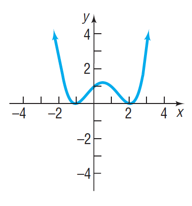
  

__Sln__: This $\box{\text{could be}}$ the graph of a polynomial because it is smooth, with no ___discontinuities___ (&quot;holes&quot;), corners (such as $y = |x|$ has at $x=0$), or cusps (such as $y = x^{2/3}$ has at $x=0$).&nbsp; The graph suggests the function has $\box{\text{zeros at }x = -1\text{ and }x = 2}$; moreover, since the graph appears to just touch the $x$-axis at these zeros, each of them must be of even multiplicity of at least 2, meaning the least degree the polynomial can have is $2(2) = \box{4.}$
  

<a name="1.64" class="goback" onclick="winhisback()">__1.64__</a>)

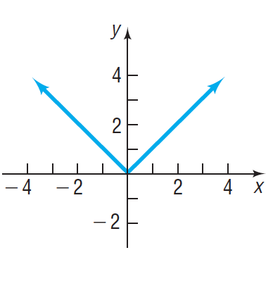
  

__Sln__: This $\box{\text{cannot}}$ be the graph of a polynomial because it has a corner.&nbsp; (The graph looks like it is the graph of $y = |x|,$ which is the fundamental example of a continuous function of all real numbers that fails to be a polynomial because it has a single corner at $(0,0).$)
  

<a name="1.68" class="goback" onclick="winhisback()">__1.68__</a>)
Construct a polynomial function that might have this graph:

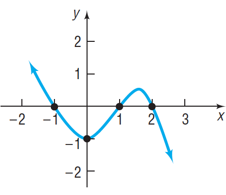
  

__Sln__: First, this can be the graph of a polynomial function because it is continuous and well-defined for all real numbers (as indicated by the arrows on the ends of the curve), and because it has the end behavior of a polynomial, specifically, growing without bound as $|x| \rightarrow \infty.$&nbsp; Its $x$-intercepts of $-1, 1, 2$ imply that the polynomial has $x - (-1) = x + 1,$ $x - 1,$ and $x - 2$ as factors; and the fact that the graph crosses the $x$-axis at each of these means that these factors occur to an odd (positive integer) power, e.g., 1 (to choose the smallest compliant value).&nbsp; Thus a polynomial function that works can have the form $f(x) = c(x+1)(x-1)(x-2)$ for some real number $c \ne 0$; but we still have one more point we require the function to pass through: $(0, -1).$&nbsp; Thus we need $c$ so that $f(0) = c(0+1)(0-1)(0-2) = 2c = -1 \implies c = -\Frac12.$&nbsp; Thus $f(x) = -\Frac12(x+1)(x-1)(x-2)$ is a polynomial which might have this graph; written in standard form, this is: $$\box{f(x) = -\frac12 x^3 + x^2 + \frac12 x - 1}$$
 

__74__, __80__, __86__) For the given polynomial function, state: __a__) the end behavior; __b__) the $x$- and $y$-intercepts; __c__) the zeros, their multiplicity, and whether the graph crosses or grazes the $x$-axis at each; __d__) the maximum number of turning points; __e__) the behavior near each $x$-intercept; and __f__) draw and label a complete graph of the function.

<a name="1.74" class="goback" onclick="winhisback()">__1.74__</a>)
$f(x) = -\Frac12(x + 4)(x - 1)^3$

__Sln__: __a__) After multiplying out, the leading term of $f$ is $-\Frac12(x)(x^3) = \box{-\frac12x^4} =$ the end behavior of $f$.

__b__) The $x$-intercepts are where $f(x) = -\Frac12(x + 4)(x - 1)^3 = 0 \implies x + 4 = 0 \implies \box{x = -4}$ or $(x - 1)^3 = 0 \implies x - 1 = 0 \implies \box{x = 1}$; the $y$-intercept is $f(0) = -\Frac12(0 + 4)(0 - 1)^3 = \box{2}$. 

__c__) The zero $\box{x = -4 \text{ has multiplicity } 1}$, and the zero $\box{x = 1 \text{ has multiplicity } 3}$; since both of these multiplicities are odd integers, the graph of $f~\box{\text{crosses}}$ the $x$-axis at both zeros.    

__d__) The degree of the polynomial is $1 + 3 = 4$ so the maximum number of turning points is $4 - 1 =\box{3}$.

__e__) Near $x = -4,~f \approx -\Frac12(x + 4)(-4 - 1)^3 = \box{\frac{125(x+4)}2}$; near $x = 1,~f \approx -\Frac12(1 + 4)(x - 1)^3 = \box{-\frac52(x-1)^3}$.

__f__) Only because Part e) asked us to calculate them, we’ve included graphs of the approximate behavior near the zeros; we haven’t included a graph of the end behavior function because we would have to zoom too far out for it to be convincing that it is indeed the end behavior (the &quot;near zero&quot; behavior of the function would be obscured).&nbsp; The turning point was determined using GeoGebra’s `Max` function, then the $x$-coordinate was confirmed to be exact using Calculus (the displayed $y$-coordinate remains approximate).
 

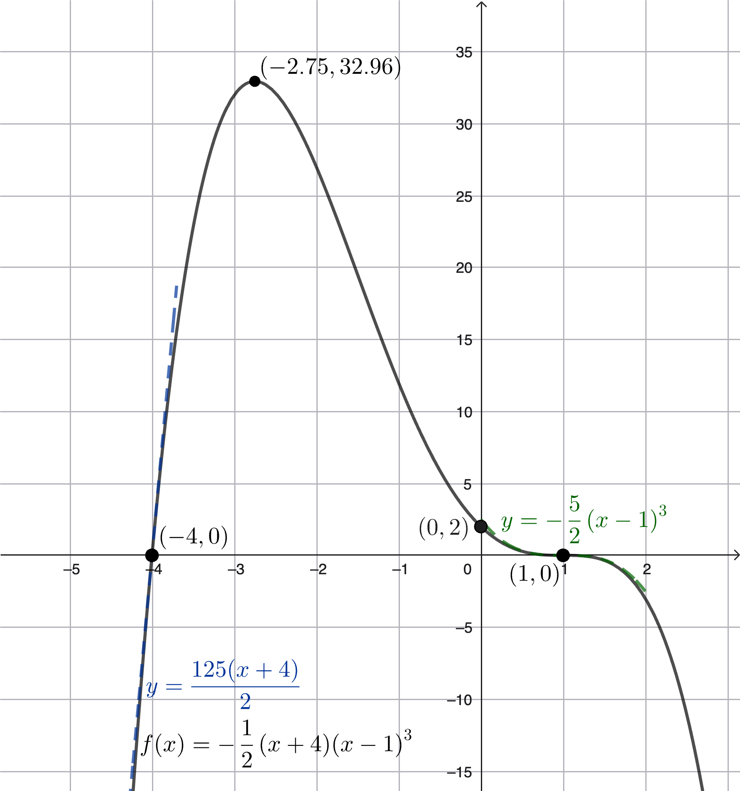
  
 

<a name="1.80" class="goback" onclick="winhisback()">__1.80__</a>)
$f(x) = (x + 1)^3(x - 3)$

__Sln__: __a__) The end behavior is given by $g(x) = (x^3)(x) = \box{x^4}$.

__b__) $(x + 1)^3(x - 3) = 0 \implies x = \box{-1, 3}$ are the $x$-intercepts; $(0 + 1)^3(0 - 3) = \box{-3}$ is the $y$-intercept.

__c__) The zero $\box{x = -1 \text{ has multiplicity } 3}$ and $\box{x = 3 \text{ has multiplicity } 1}$; again, since these multiplicities are odd, the graph of $f ~\box{\text{crosses}}$ the $x$-axis at both zeros.

__d__) The degree of the polynomial is $3 + 1 = 4$ so the maximum number of turning points is $4 - 1 =\box{3}$.

__e__) Near $x = -1,~f \approx (x + 1)^3(-1 - 3) = \box{-4(x + 1)^3}$; near $x = 3,~f \approx (3 + 1)^3(x - 3) = \box{64(x-3)}$.

__f__) Again we have provided graphs of the approximating functions near the zeros, but not the end behavior function.&nbsp; Both coordinates of the turning point are exact (confirmed using Calculus).

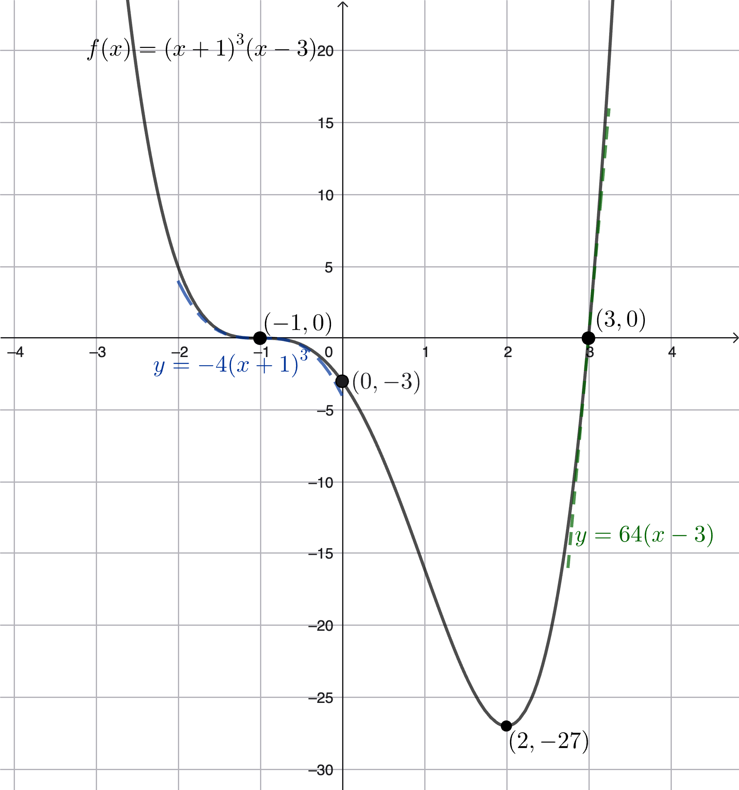
  
 

<a name="1.86" class="goback" onclick="winhisback()">__1.86__</a>)
$f(x) = x^2(x^2 + 1)(x + 4)$

__Sln__: __a__) The end behavior is given by $g(x) = (x^2)(x^2)(x) = \box{x^5}$.

__b__) $x^2(x^2 + 1)(x + 4) = 0 \implies x = \box{0, -4}$ are the $x$-intercepts ($x^2 + 1$ has no real zeros); $0^2(0^2+1)(0+4) = \box{0}$ is the $y$-intercept.

__c__) The zero $\box{x = 0 \text{ has multiplicity } 2}$, which is even, so the graph of $f~\box{\text{grazes}}$ the $x$-axis at $x = 0$; the zero $\box{x = -4 \text{ has multiplicity } 1}$ so the graph of $f~\box{\text{crosses}}$ the $x$-axis at $x = -4$.

__d__) The degree of the polynomial is $2 + 2 + 1 = 5$ so the maximum number of turning points is $5 - 1 =\box{4}$.

__e__) Near $x = 0,~f \approx x^2(0^2 + 1)(0 + 4) = \box{4x^2}$; near $x = -4,~f \approx (-4)^2((-4)^2 + 1)(x + 4) = \box{272(x + 4)}$.

__f__) The turning point is approximate, determined using GeoGebra’s `Max` function; again we have provided graphs of the approximating functions near the zeros.

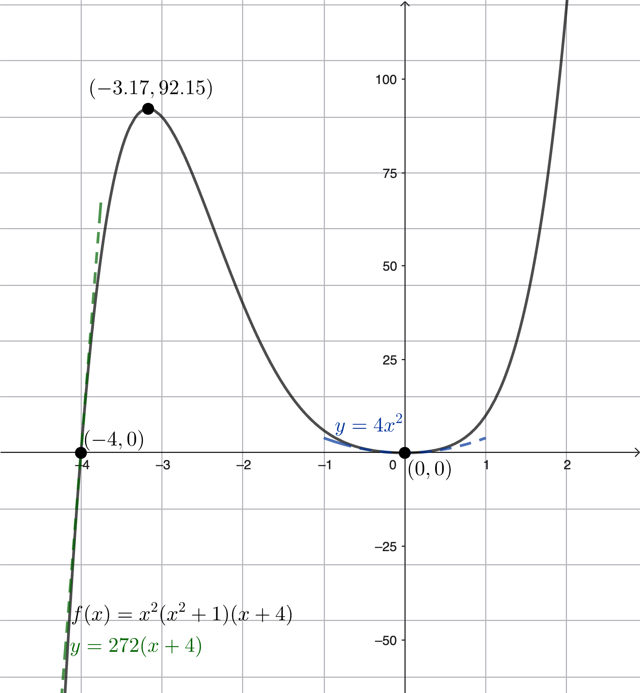
  
 

__90__, __94__) For the given polynomial function, using a graphing utility when necessary: __a__) state the end behavior; __b__ & __f__) graph it, and label the graph (as a proxy for graphing it by hand); __c__) approximate the $x$- and $y$-intercepts; __e__) approximate the turning points; __g__) state the domain and range of the function; __h__) state where the function is increasing and where it is decreasing.

<a name="1.90" class="goback" onclick="winhisback()">__1.90__</a>)
$f(x) = x^3 - 2.91x^2 - 7.668x - 3.8151$

__Sln__: __a__) The end behavior is that of $\box{x^3}$.

__b__, __f__) The coordinates of the zeros were approximated using GeoGebra’s `Root` command (the zeros of a function are also called its roots); the coordinates of the turning points were approximated using GeoGebra’s `Max` and `Min` commands (the former confirming that the point $(-0.9,0)$ is both a zero and a &quot;local maximum&quot; turning point); and the $y$-intercept is apparent by inspection (for polynomials, the $y$-intercept is always the constant term).

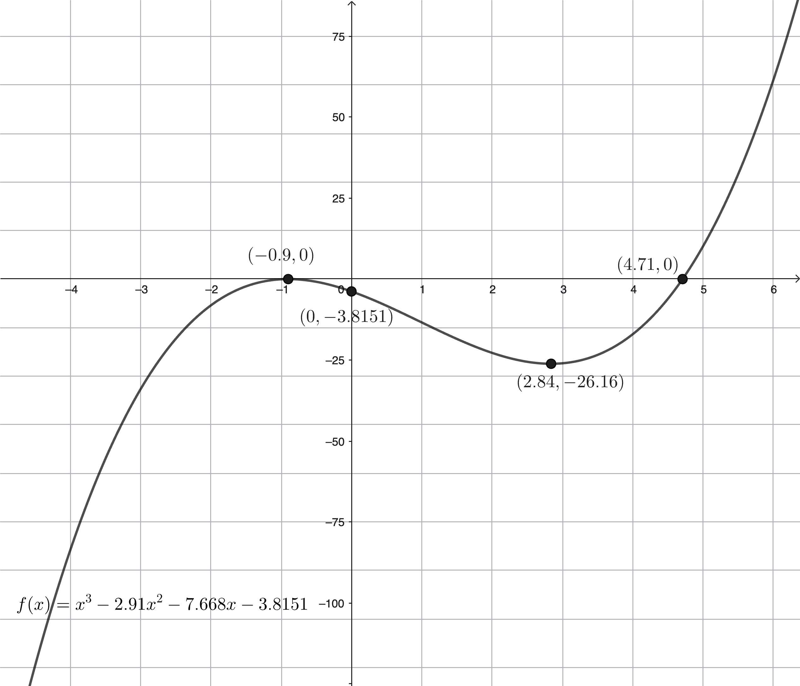

__c__) From the graph, we see that the $x$-intercepts are approximately $\box{(-0.9, 0)}$ and $\box{(4.71, 0)}$ and there is never any need to approximate the $y$-intercept of a polynomial given in standard form, it is always the constant term, so in this case it is exactly $\box{(0, -3.8151)}$.

__e__) The turning points are seen to be approximately $\box{(-0.9, 0)}$ which is a local maximum, and $\box{(2.84, -26.16)}$ which is a local minimum.

__g__) $\box{\text{Dom. } = \mathbb{R}}$ (as it does for all polynomials) and since it has odd degree, $\box{\text{Ran. } = \mathbb{R}}$ also.

__h__) The function is increasing for $x$ from $-\infty$ up-to-but-not-including the $x$-coordinate of the first turning point, $-0.9$, i.e., on the open interval $(-\infty, -0.9)$; then it is decreasing from-but-not-including this point up-to-but-not-including the $x$-coordinate of the next turning point, $2.84$, i.e., on the open interval $(-0.9, 2.84)$; then it is increasing again from-but-not-including this point to $\infty$, i.e., on the open interval $(2.84, \infty)$.&nbsp; Using set notation, $f$ is $\box{\text{increasing on }(-\infty, -0.9) \cup (2.84, \infty)}$ and $\box{\text{decreasing on (-0.9, 2.84)}}$.
  

<a name="1.94" class="goback" onclick="winhisback()">__1.94__</a>)
$f(x) = -1.2x^4 + 0.5x^2 - \sqrt3x + 2$

__Sln__: __a__)

__b__) 

__c__)

__e__)

__f__)

__g__)

__h__)

  

__98__, __102__) For the given polynomial function, state: __a__) the end behavior; __b__) the $x$- and $y$-intercepts; __c__) the zeros, their multiplicity, and whether the graph crosses or grazes the $x$-axis at each; __d__) the maximum number of turning points; __e__) the behavior near each $x$-intercept; and __f__) draw and label a complete graph of the function (hint: begin by factoring the polynomial over the set of real numbers).

<a name="1.98" class="goback" onclick="winhisback()">__1.98__</a>)
$f(x) = x^3 + 2x^2 - 8x$

__Sln__:
  

<a name="1.102" class="goback" onclick="winhisback()">__1.102__</a>)
$f(x) = -x^5 + 5x^4 + 4x^3 - 20x^2$

__Sln__:
  

<a name="1.106" class="goback" onclick="winhisback()">__1.106__</a>)

__Sln__:
  

<a name="1.114" class="goback" onclick="winhisback()">__1.114__</a>)

__Sln__:
  

<a name="1.118" class="goback" onclick="winhisback()">__1.118__</a>)

__Sln__:
  

## Section 2: Properties of Rational Functions

<a name="2.6" class="goback" onclick="winhisback()">__2.6__</a>)

__Sln__:
  

<a name="2.8" class="goback" onclick="winhisback()">__2.8__</a>)

__Sln__:
  

<a name="2.10" class="goback" onclick="winhisback()">__2.10__</a>)

__Sln__:
  

<a name="2.12" class="goback" onclick="winhisback()">__2.12__</a>)

__Sln__:
  

<a name="2.18" class="goback" onclick="winhisback()">__2.18__</a>)

__Sln__:
  

<a name="2.20" class="goback" onclick="winhisback()">__2.20__</a>)

__Sln__:
  

<a name="2.22" class="goback" onclick="winhisback()">__2.22__</a>)

__Sln__:
  

<a name="2.24" class="goback" onclick="winhisback()">__2.24__</a>)

__Sln__:
  

<a name="2.46" class="goback" onclick="winhisback()">__2.46__</a>)

__Sln__:
  

<a name="2.50" class="goback" onclick="winhisback()">__2.50__</a>)

__Sln__:
  

<a name="2.54" class="goback" onclick="winhisback()">__2.54__</a>)

__Sln__:
  

<a name="2.56" class="goback" onclick="winhisback()">__2.56__</a>)

__Sln__:
  

<a name="2.61" class="goback" onclick="winhisback()">__2.61__</a>)

__Sln__:
  

## Section 3: The Graph of a Rational Function

<a name="3.8" class="goback" onclick="winhisback()">__3.8__</a>)

__Sln__:
  

<a name="3.14" class="goback" onclick="winhisback()">__3.14__</a>)

__Sln__:
  

<a name="3.20" class="goback" onclick="winhisback()">__3.20__</a>)

__Sln__:
  

<a name="3.26" class="goback" onclick="winhisback()">__3.26__</a>)

__Sln__:
  

<a name="3.32" class="goback" onclick="winhisback()">__3.32__</a>)

__Sln__:
  

<a name="3.38" class="goback" onclick="winhisback()">__3.38__</a>)

__Sln__:
  

<a name="3.44" class="goback" onclick="winhisback()">__3.44__</a>)

__Sln__:
  

<a name="3.48" class="goback" onclick="winhisback()">__3.48__</a>)

__Sln__:
  

<a name="3.54" class="goback" onclick="winhisback()">__3.54__</a>)

__Sln__:
  

## Section 4: Polynomial and Rational Inequalities

<a name="4.8" class="goback" onclick="winhisback()">__4.8__</a>)
Given the following graph of $f(x)$:

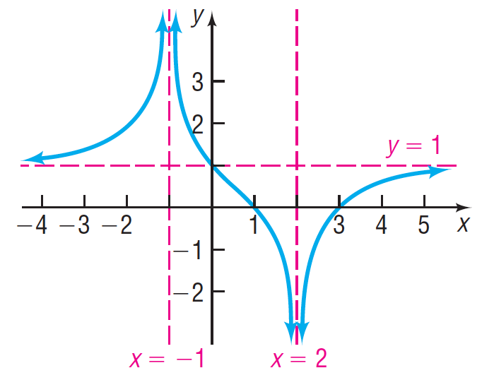
  
Solve __a__) $f(x) \gt 0$; and __b__) $f(x) \le 0$
 
__Sln__: Graphs are imprecise for this purpose, and involve various conventions, but it is a skill that students are expected to learn, so, here we go.&nbsp; Moving from left to right: the graph having an arrow indicates that it is defined for all $x$ values &quot;off-screen&quot;; the graph not intersecting the horizontal asymptote $y=1$ implies that it never goes below that value, and thus $\gt 0,$ as $x$ gets increasingly negative (if it did go below that value, by convention, the graph should indicate that, because otherwise you’d have no way of knowing, since you don’t have a formula to analyze).&nbsp; Similarly, the arrow as the graph approaches the asymptote implies, by convention, that $f$ is well-defined for all $x$ up to, but not including, the $x$ value of the asymptote; and this graph clearly indicates that that $f(x) \gt 0$ up to the asymptote, so $f(x) \gt 0$ on $(-\infty, -1)$ ($f(-1)$ is undefined so $f$ can’t have any relation, $\lt, =,$ or $\gt,$ to $0$ at $x=-1$).&nbsp;  
  

__14__, __18__) Solve the given inequality graphically.

<a name="4.14" class="goback" onclick="winhisback()">__4.14__</a>)
$f(x) = -\Frac12(x+4)(x-1)^3 \lt 0$

__Sln__:
  

<a name="4.18" class="goback" onclick="winhisback()">__4.18__</a>)
$R(x) = \Frac{2x+4}{x-1} \ge 0$

__Sln__:
  

__24__, __30__, __36__, __42__, __48__) Solve the given inequality algebraically.

<a name="4.24" class="goback" onclick="winhisback()">__4.24__</a>)
$3x^3 \lt -15x^2$

__Sln__: Begin by adding $15x^2$ to both sides to obtain the equivalent inequality $3x^3 + 15x^2 \lt 0$; then find the endpoints of the intervals to check by solving the corresponding equality $3x^3 + 15x^2 = 3x^2(x+5)=0 \implies x = -5$ and $x=0$ are the required endpoints, i.e., the intervals to check are $(-\infty,-5), (-5,0)$ and $(0,\infty).$&nbsp; To check $(-\infty,-5),$ we choose (arbitrarily: any value in the interval will do) $x=-6$: $3(-6)^3 = -648 \lt -15(-6)^2=-540,$ so $(-\infty, -5)$ is in the solution set; to check $(-5,0),$ we choose $x=-1$ (again, arbitrarily): $3(-1)^3 = -3 \gt -15(-1)^2 = -15,$ so $(-5,0)$ is not in the solution set; and to check $(0,\infty),$ we choose $x=1$: $3(1)^2 = 3 \gt -15(1)^2 = -15,$ so $(0, infty)$ is also not in the solution set.&nbsp; Summarizing, the solution set is $\box{(-\infty,-5)\!\!}$; here’s graphical confirmation:

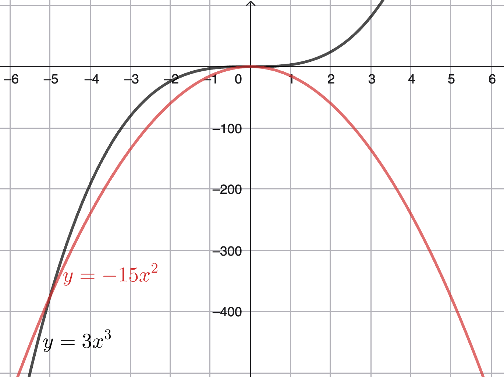
  
 

<a name="4.30" class="goback" onclick="winhisback()">__4.30__</a>)
$x^4 \lt 9x^2$

__Sln__: $x^4 \lt 9x^2 \implies x^4 - 9x^2 \lt 0$; $x^4 - 9x^2 = x^2(x+3)(x-3) = 0 \implies -3, 0, 3$ are the interval endpoints; checking $x = -4: (-4)^4 = 256 \gt 9(-4)^2=144 \implies (-\infty,-3)$ is excluded; $x = -1: (-1)^4 = 1 \lt 9(-1)^2 = 9 \implies (-3,0)$ is included; $x = 1: 9(1)^4 = \lt 9(1)^2 = 9 \implies (0, 3)$ is included; $x = 4: (4)^4 = 256 \gt 9(4)^2 = 144 \implies (3,\infty)$ excluded.&nbsp; Final answer: $\box{(-3,0) \cup (0,3).\!\!}$&nbsp; (Make sure you understand, reader, why $0$ is NOT in the solution set.)&nbsp; Here’s a confirmation graph:

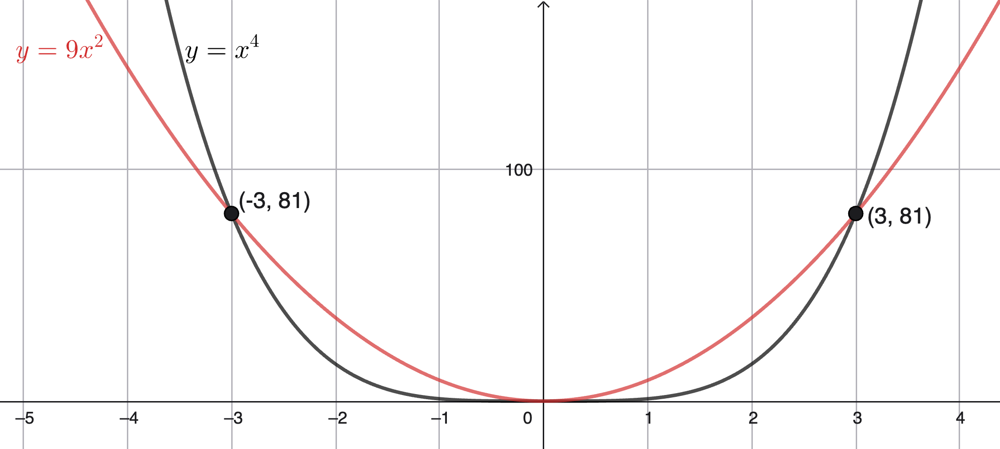
  
 

<a name="4.36" class="goback" onclick="winhisback()">__4.36__</a>)
$\Frac{(x-3)(x+2)}{x-1} \le 0$

__Sln__: The interval endpoints are the zeros of $x-3, x+2,$ and $x-1,$ which are $3, -2,$ and $1$ respectively.&nbsp; Since the inequality is $\le$ and the left-hand-side (LHS) expression is well-defined and true for $x = 3$ and $x = -2,$ these values will be in the solution set; but $x = 1$ is excluded because the LHS is undefined there.&nbsp; To check the interval $(-\infty, -2),$ we choose $x = -3: \Frac{(-3-3)(-3+2)}{-3-1} = \Frac{(-6)(-1)}{-4} \lt 0 \implies (-\infty, -2)$ is in the solution set; $\Frac{(0-3)(0+2)}{0-1} = \Frac{(-3)(2)}{-1} \gt 0 \implies (-2, 1)$ is excluded; $\Frac{(2-3)(2+2)}{2-1} = \Frac{(-1)(4)}{1} \lt 0 \implies (1,3)$ is included; and finally $\Frac{(4-3)(4+2)}{4-1} = \Frac{(1)(6)}{3} \gt 0 \implies (3, \infty)$ is included.&nbsp; Thus the solution set is $\box{(-\infty, -2] \cup (1,3].\!\!}$&nbsp; (Checking this with a graphing utility is left to the reader.) 
  

<a name="4.42" class="goback" onclick="winhisback()">__4.42__</a>)
$\Frac{x-4}{2x+4} \ge 1$

__Sln__: Subtract 1 from both sides to obtain $\Frac{x-4}{2x+4} - 1 = \Frac{x-4 - (2x+4)}{2x+4} = \Frac{-x - 8}{2(x+2)} \ge 0$ and then multiply through by $-2$ to get $\Frac{x + 8}{x+2} \le 0$; thus the endpoints of the intervals are $-8$ and $-2.$&nbsp; The left-hand-side (LHS) of the inequality is well-defined and $=0$ for $x=-8$ so $-8$ will be part of the solutions set; but the LHS is undefined for $x=-2$ so $-2$ must be excluded.&nbsp; Next we choose a representative value from each of the three intervals $(-\infty, -8), (-8,-2),$ and $(-2, \infty)$ to determine the sign over each: $\Frac{-9+8}{-9+2} = \Frac17 \gt 0$ so $(-\infty, -8)$ is excluded from the solution set; $\Frac{-4+8}{-4+2} = -2 \lt 0$ so $[-8,-2)$ is in the solution set; and $\Frac{0+8}{0+2} = 4 \gt 0$ so $(-2,\infty)$ is excluded.&nbsp; Final answer: $\box{[-8,-2).\!\!}$&nbsp; Here’s graphical confirmation:

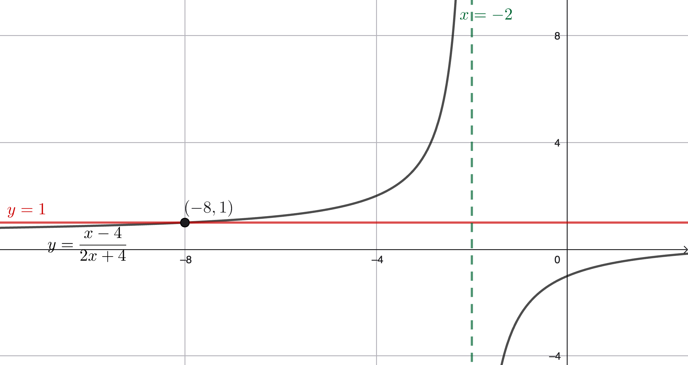
 
 

<a name="4.48" class="goback" onclick="winhisback()">__4.48__</a>)
$\Frac{(2-x)^3(3x-2)}{x^3+1} \lt 0$

__Sln__: The endpoints of the intervals to check&mdash;which will be excluded from the solution set because the inequality is strict&mdash;are the solutions of $(2-x)^3=0, 3x-2 = 0$ and $x^3+1 = 0.$&nbsp; The solution of $(2-x)^3 = 0$ is $x=2,$ the solution of $3x-2 = 0$ is $x=\Frac23,$ and the only real solution of $x^3+1 = 0$ is $x=-1$ (verification of this last assertion is left to the reader).&nbsp; So the intervals we need to check are $(-\infty, -1), \left(-1, \Frac23\right), \left(\Frac23, 2\right),$ and $(2,\infty).$&nbsp; $\Frac{(2-(-2))^3(3(-2)-2)}{(-2)^3+1} = \Frac{(64)(-8)}{-7} \gt 0 \implies (-\infty, -1)$ is excluded; $\Frac{(2-0)^3(3(0)-2)}{0^3+1} = 8(-2) \lt 0 \implies \left(-1,\Frac23\right)$ is included; $\Frac{(2-1)^3(3(1)-2)}{1^3+1} = \Frac12 \gt 0$ so $\left(\Frac23, 2\right)$ is excluded; and $\Frac{(2-3)^3(3(3)-2)}{3^3 + 1} = \Frac{(-1)(7)}{28} \lt 0 \implies (2,\infty)$ is included.&nbsp; Thus the solution set is $\box{\left(-1,\frac23\right) \cup (2,\infty).\!\!\!}$&nbsp; (This one is interesting because it’s not straightforward to verify graphically&mdash;here’s its graph in the default window provided by GeoGebra:

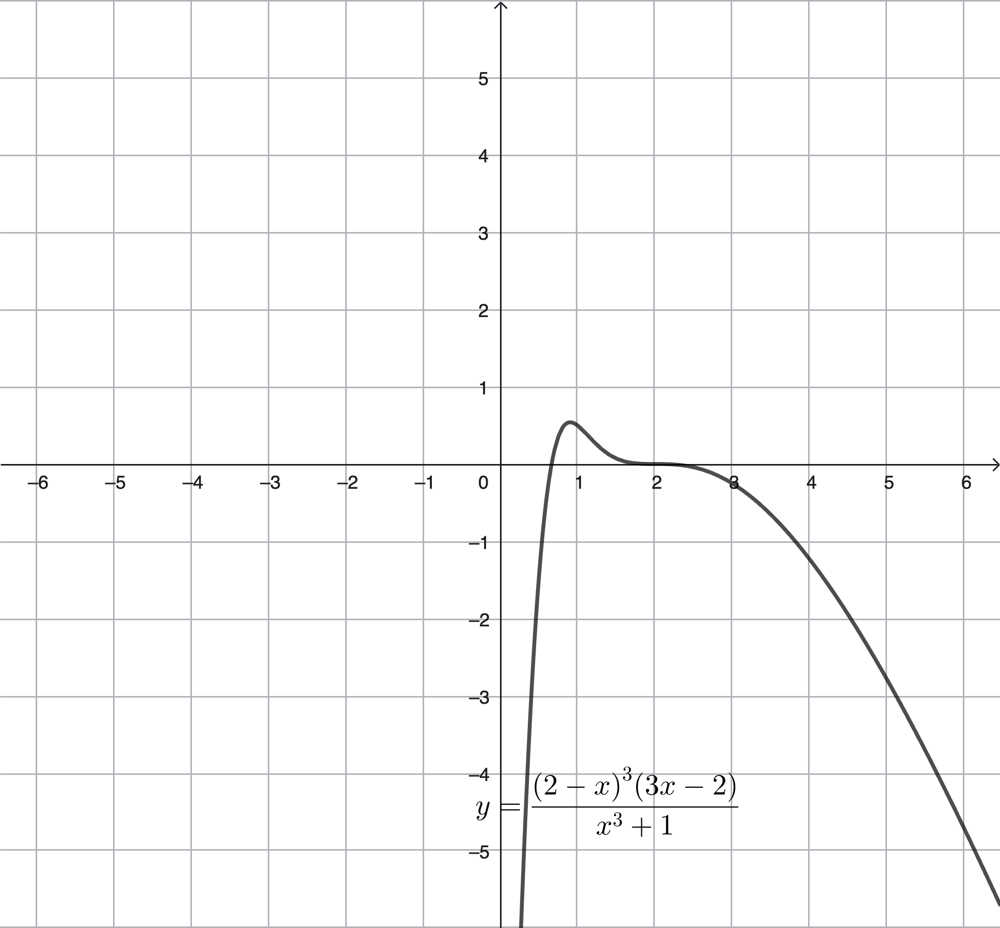
 
It’s not too difficult to convince oneself that $x=2$ is the right-most boundary point beyond which the graph is negative; likewise, the graph is negative immediately to the left of a value that looks to be about $\Frac23.$&nbsp; However, it’s not clear in this viewing window that the function is even well-defined for negative $x$, much less positive to the left of $x=-1$; one has to zoom out considerably:

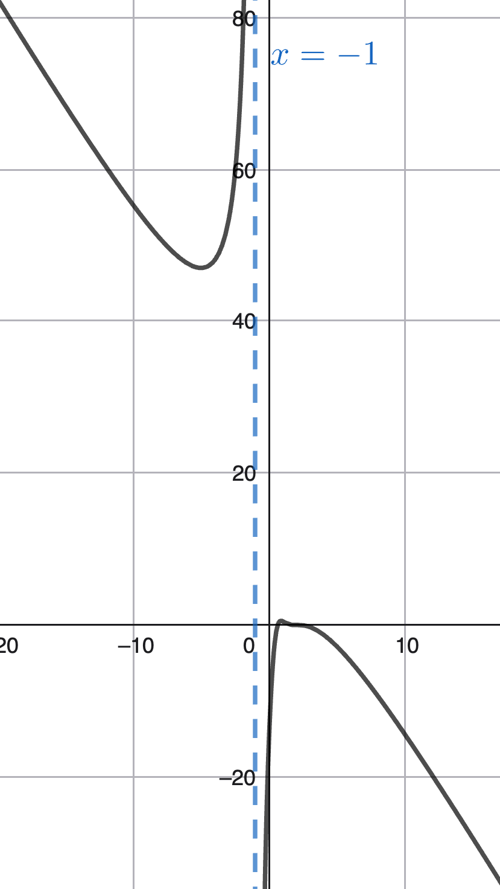
 
to see the portion of the graph that’s positive to the left of the vertical asymptote $x=-1,$ so much so that one can no longer use the graph to accurately estimate the endpoints of the intervals over which the graph is negative.&nbsp; Thus here’s an example of an inequality that really needs to be analyzed algebraically&mdash;if one jumps straight to a graphical analysis, one could easily misidentify the true solution set.)
  

__54__, __60__) Solve the given inequality.

<a name="4.54" class="goback" onclick="winhisback()">__4.54__</a>)
$\Frac{x - 1}{x + 2} \ge -2$

__Sln__: Adding $2$ to both sides and simplifying yields $\Frac{x-1}{x+2} + \Frac{2(x+2)}{x+2} = \Frac{3(x+1)}{x+2} \ge 0 \implies \Frac{x+1}{x+2} \ge 0$ as an equivalent inequality.&nbsp; Thus $x = -2, -1$ are the endpoints of the intervals we must inspect: $\Frac{-3+1}{-3+2} = 2 \gt 0 \implies (-\infty, -2)$ is in the solution set; $\Frac{-1.5+1}{-1.5+2} = -1 \lt 0$ so $(-2,-1)$ is excluded; $\Frac{0+1}{0+2} = \Frac12 \gt 0 \implies (-1,\infty)$ is included, as is the endpoint $x=1.$&nbsp; Thus the solution set is $\box{(-\infty,-2) \cup [-1,\infty).\!\!\!}$&nbsp; Here’s a &quot;confirmation graph&quot;:

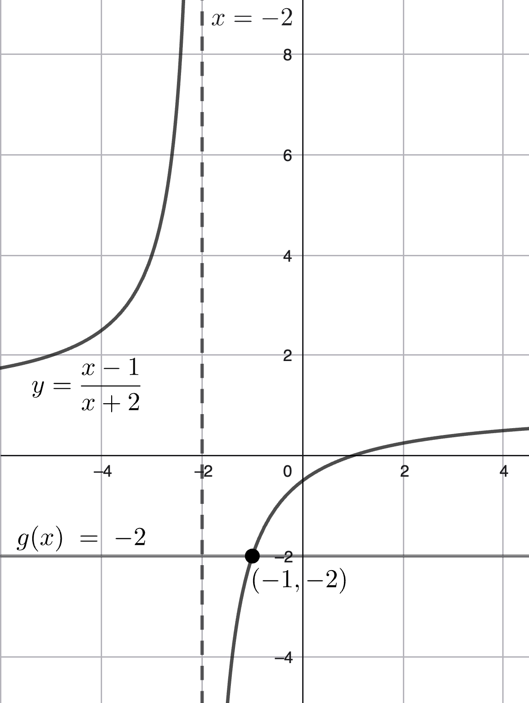
 
 

<a name="4.60" class="goback" onclick="winhisback()">__4.60__</a>)
$x^3 - x \ge 0$

__Sln__: Solving $0 = x^3 - x = x(x^2 - 1) = x(x-1)(x+1) \implies -1, 0, 1,$ which are themselves part of the solution set since the inequality includes equals, are the endpoints of the intervals we must inspect.&nbsp; $(-2)^3 - (-2) = -8 + 2 = -6 \lt 0$ so $(-\infty,-1)$ is not part of the solution set; $\left(-\Frac12\right)^3 - \left(-\Frac12\right) = -\Frac18 + \Frac12 = \Frac38 \gt 0$ so $(-1,0)$ is part of the solution set; $\left(\Frac12\right)^3 - \left(\Frac12\right) = \Frac18 - \Frac12 = -\Frac38 \lt 0$ so $(0,1)$ is excluded; and $2^3 - 2 = 6 \gt 0 \implies (1,\infty)$ is included.&nbsp; Thus the complete solution set is $\box{[-1,0] \cup [1,\infty).\!\!}$&nbsp; (Another way to see/get this is to think about the graph of $f(x) = x^3 - x$ using the tools developed earlier in this chapter: the reader is encouraged to try that approach.)
  

<a name="4.66" class="goback" onclick="winhisback()">__4.66__</a>)
What is the domain of the function $f(x) = \sqrt{\Frac{x-1}{x+4}}$?
__Sln__: It is the solution set of the inequality $\Frac{x-1}{x+4} \ge 0$ with $x = -4$ excluded.&nbsp; Therefore, the intervals we need to inspect are $x \lt -4, -4 \lt x \lt 1,$ and $x \gt 1$ ($x = 1$ is in the domain because $f$ is well-defined there &quot;by inspection&quot;).&nbsp; $\Frac{-5-1}{-5+4} = \Frac{-6}{-1} \gt 0$ so $x \lt -4$ is in the domain; $\Frac{0-1}{0+4} = \Frac{-1}4 \lt 0$ so $-4 \lt x \lt 1$ is excluded; $\Frac{2-1}{2+4} = \Frac16 \gt 0$ so $x \gt 1$ is in the domain.&nbsp; Putting this altogether using interval notation: $\box{\text{Dom} = (-\infty, -4) \cup [1,\infty).\!\!\!\!}$&nbsp; (The reader should use the graphing skills developed in the previous section to establish that the graph of $\Frac{x-1}{x+4}$ supports this result.)
  

<a name="4.70" class="goback" onclick="winhisback()">__4.70__</a>)
Determine algebraically where the graph of $f(x) = x^4$ is below the graph of $g(x) = 2 - x^2$ by solving $f(x) \lt g(x)$ and graph both functions on the same set of axes to confirm.

__Sln__: First note that there is a slight &quot;typo&quot; in the problem statement in (my edition of) the text: it gives $f(x) \le g(x)$ as the inequality to solve, but $f(x)$ is not below $g(x)$ where $f(x) = g(x).$ With that noted, we are asked to solve $x^4 \lt 2 - x^2 \implies x^4 + x^2 - 2 \lt 0$ and we need to find the real solutions, if any, of $x^4 + x^2 - 2 = 0$ to determine the end points of the interval(s) over which the inequality will be true.&nbsp; $x^4 + x^2 - 2 = 0$ is &quot;quadratic-in-form&quot; so we make the variable substitution $y = x^2$ yielding $y^2 + y - 2 = 0 \implies y = \Frac{-1 \pm \sqrt{1^2 - 4(1)(-2)}}2 = \Frac{-1 \pm 3}2 \implies y = x^2 = 1$ or $-2.$&nbsp; $x^2 = -2$ has no real solutions, so the real solutions are $x = \pm1,$ so these are the endpoints of the interval over which the inequality is true.&nbsp; Checking the interior abscissa $x=0$ yields $0^4 + 0^2 - 2 = -2 \lt 0$ so $\box{-1 \lt x \lt 1}$ is the interval over which the graph of $f(x) = x^4$ is below the graph of $g(x) = 2 - x^x.$&nbsp; Here’s the required confirmation graph:

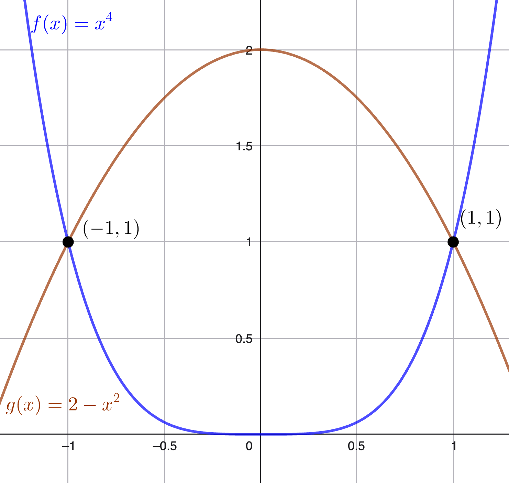

 

<a name="4.74" class="goback" onclick="winhisback()">__4.74__</a>)
How far along a straight line between the Earth and the moon does an object need to be for the gravitational force on it due to the moon to be greater than the gravitational force on it due to the Earth?&nbsp; Relevant info: the gravitational force between two objects is
$$F = G\frac{m_1m_2}{r^2}$$
where: $m_1, m_2$ are the masses of the two objects; $r$ is the distance between them; and $G = 6.6742 \times 10^{-11}$ N-m$^2$/kg$^2$; the mass of the Earth $m_E = 5.9742 \times 10^{24}$ kg; the mass of the moon $m_n = 7.349 \times 10^{22}$ kg; and the mean (i.e., average) distance between the Earth and the moon is $3.844 \times 10^5$ km.
 
__Sln__: 
  

## Section 5: The Real Zeros of a Polynomial Function

__14__, __20__) Use the Remainder Theorem to find the remainder when $f(x)$ is divided by $x - c$ and use the Factor Theorem to
determine whether $x - c$ is a factor of $f.$

<a name="5.14" class="goback" onclick="winhisback()">__5.14__</a>)
$f(x) = 4x^4 - 15x^2 - 4$; $x - 2$

__Sln__:
  

<a name="5.20" class="goback" onclick="winhisback()">__5.20__</a>)
$f(x) = 3x^4 + x^3 - 3x + 1$; $x + \Frac13$

__Sln__:
  

__26__, __32__) State the maximum number of real zeros the given polynomial function may have; do not attempt to find the zeros

<a name="5.26" class="goback" onclick="winhisback()">__5.26__</a>)
$f(x) = -x^3 - x^2 + x + 1$

__Sln__:
  

<a name="5.32" class="goback" onclick="winhisback()">__5.32__</a>)
$f(x) = x^6 + 1$

__Sln__:
  

__38__, __44__) List the potential rational zeros of the given polynomial function; do not attempt to find the zeros.

<a name="5.38" class="goback" onclick="winhisback()">__5.38__</a>)
$f(x) = 6x^4 - x^2 + 2$

__Sln__:
  

<a name="5.44" class="goback" onclick="winhisback()">__5.44__</a>)
$f(x) = -6x^3 - x^2 + x + 10$

__Sln__:
  

__48__, __52__, __56__) Use the Rational Zeros Theorem to find all the real zeros of the given polynomial function and thereby factor the polynomial.

<a name="5.48" class="goback" onclick="winhisback()">__5.48__</a>)
$f(x) = 2x^3 + x^2 + 2x + 1$

__Sln__:
  

<a name="5.52" class="goback" onclick="winhisback()">__5.52__</a>)
$f(x) = 2x^4 - x^3 - 5x^2 + 2x + 2$

__Sln__:
  

<a name="5.56" class="goback" onclick="winhisback()">__5.56__</a>)
$f(x) = 3x^4 + 4x^3 + 7x^2 + 8x + 2$

__Sln__:
  

__60__, __64__, __68__) Solve the given equation over the reals.

<a name="5.60" class="goback" onclick="winhisback()">__5.60__</a>)
$2x^3 - 3x^2 - 3x - 5 = 0$

__Sln__:
  

<a name="5.64" class="goback" onclick="winhisback()">__5.64__</a>)
$x^4 - 2x^3 + 10x^2 - 18x + 9 = 0$

__Sln__:
  

<a name="5.68" class="goback" onclick="winhisback()">__5.68__</a>)
$2x^4 + x^3 - 24x^2 + 20x + 16 = 0$

__Sln__:
  

<a name="5.74" class="goback" onclick="winhisback()">__5.74__</a>)
Find bounds on the real zeros of $f(x) = 3x^4 - 3x^3 - 5x^2 + 27x - 36$

__Sln__:
  

<a name="5.80" class="goback" onclick="winhisback()">__5.80__</a>)
Use the Intermediate Value Theorem to show that $f(x) = 3x^3 - 10x + 9$ has a zero in $[-3, -2]$.

__Sln__:
  

__96__, __102__) Graph and adequately label the given polynomial function.

<a name="5.96" class="goback" onclick="winhisback()">__5.96__</a>)
$f(x) = x^4 - 3x^2 - 4$

__Sln__:
  

<a name="5.102" class="goback" onclick="winhisback()">__5.102__</a>)
$f(x) = 4x^5 + 12x^4 - x - 3$

__Sln__:
  

<a name="5.108" class="goback" onclick="winhisback()">__5.108__</a>)
Use the Factor Theorem to prove that $x+c$ is a factor of $x^n + c^n$ if $n \ge 1$ is an odd integer.

__Sln__:
  

<a name="5.112" class="goback" onclick="winhisback()">__5.112__</a>)
What is the length of the edge of a cube if its volume could be doubled by an increase of 6 centimeters in one edge, an increase of 12 centimeters in a second edge, and a decrease of 4 centimeters in the third edge? 

__Sln__: First note that the resulting ___paralelipiped___ (&quot;box&quot;) will not be a cube, so don’t be thinking that you’re trying to find a new cube that satisfies the requirements.
  

## Section 6: Complex Zeros; Fundamental Theorem of Algebra

<a name="6.6" class="goback" onclick="winhisback()">__6.6__</a>)
_True or False_: A polynomial function of degree 4 with real coefficients could have $-3, 2+i, 2-i,$ and $-3+5i$ as its
zeros.

__Sln__:
  

__10__, __16__) Using the given information about a polynomial function $f(x)$ whose coefficients are real numbers, find the remaining zeros of $f.$

<a name="6.10" class="goback" onclick="winhisback()">__6.10__</a>)
Degree 4; zeros: $1, 2, 2 + i$

__Sln__:
  

<a name="6.16" class="goback" onclick="winhisback()">__6.16__</a>)
Degree 6; zeros: $i, 3 - 2i, -2 + i$

__Sln__:
  

<a name="6.22" class="goback" onclick="winhisback()">__6.22__</a>)
Form a polynomial function $f(x)$ with real coefficients having degree $5$ and zeros $1$ (with multiplicity $3$) and $1+i$
  
__Sln__:
  

__26__, __28__, __30__) Use the given zero to find the remaining zeros of each function.

<a name="6.26" class="goback" onclick="winhisback()">__6.26__</a>)
$h(x) = 3x^4 + 5x^3 + 25x^2 + 45x - 18$; zero: $3i$

__Sln__:
  

<a name="6.28" class="goback" onclick="winhisback()">__6.28__</a>)
$f(x) = x^4 - 7x^3 + 14x^2 - 38x - 60$; zero: $1 + 3i$

__Sln__:
  

<a name="6.30" class="goback" onclick="winhisback()">__6.30__</a>)
$g(x) = 2x^5 - 3x^4 - 5x^3 - 15x^2 - 207x + 108$; zero: $3i$

__Sln__:
  

__32__, __36__, __40__) Find all the zeros of each polynomial function and write $f$ in factored form.

<a name="6.32" class="goback" onclick="winhisback()">__6.32__</a>)
$f(x) = x^4 - 1$

__Sln__:
  

<a name="6.36" class="goback" onclick="winhisback()">__6.36__</a>)
$f(x) = x^4 + 13x^2 + 36$

__Sln__:
  

<a name="6.40" class="goback" onclick="winhisback()">__6.40__</a>)
$f(x) = 2x^4 + x^3 - 35x^2 - 113x + 65$

__Sln__:
  

### Credits

Graphs generated using [GeoGebra](http://www.geogebra.org/).

### Please Donate:

<table>
  <tr>
    <td>
      <b>Venmo: @David-Goldsmith-13</b>
    </td>
    <td>
      <form action="https://www.paypal.com/cgi-bin/webscr"
            method="post"><input name="cmd"
            value="_xclick" type="hidden"> <input name="business"
            value="dgoldsmith_89@alumni.brown.edu" type="hidden"> <input
            name="item_name" value="SelectedSolutions Donation"
            type="hidden"> <input name="cn" value="Special Instructions
            (optional" type="hidden"> <input
            src="https://www.paypal.com/images/x-click-but04.gif"
            name="submit" alt="Make payments with PayPal - it's fast,
            free and secure!" align="middle" border="0" type="image"></form>
    </td>
  </tr>
</table>

